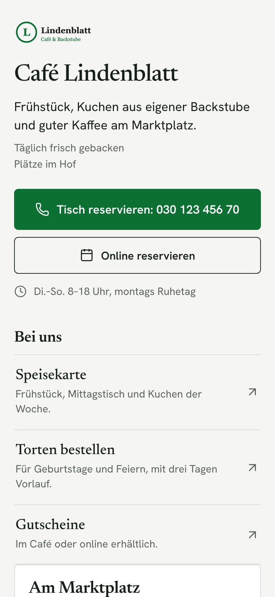
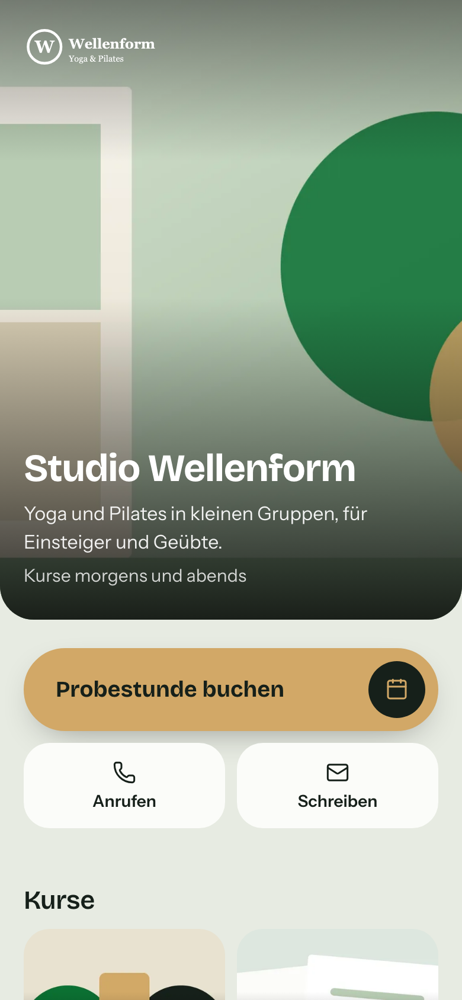
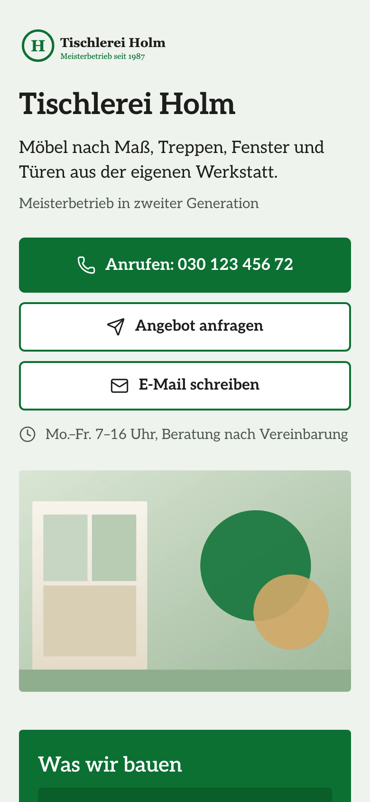
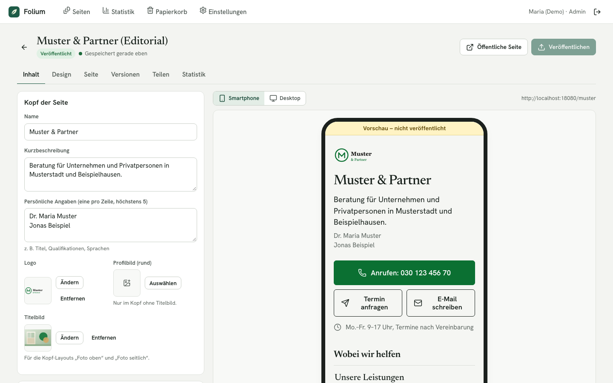
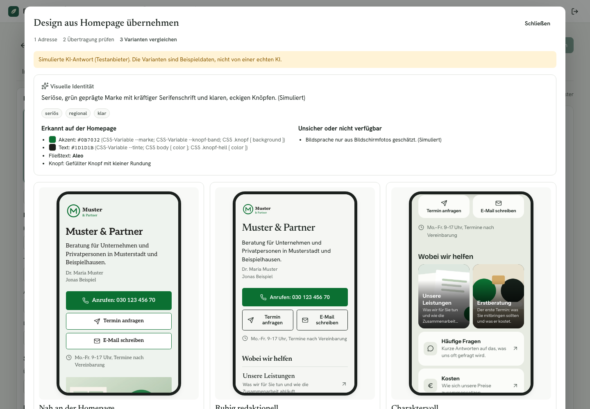
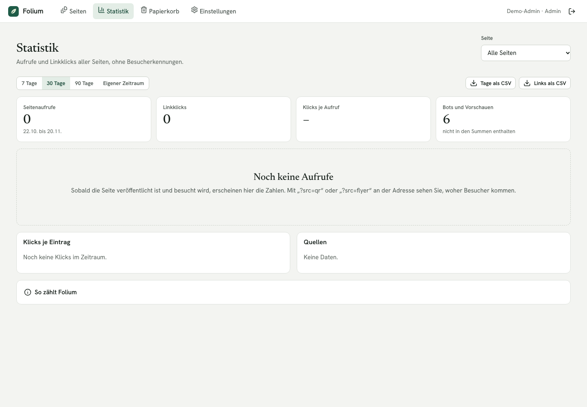

# Folium

[](https://github.com/PBaumfalk/Folium/actions/workflows/ci.yml)
[](LICENSE)
[](https://github.com/PBaumfalk/Folium/pkgs/container/folium)

**Linkseiten wie bei Linktree, aber auf der eigenen Domain, im eigenen Design und ohne Tracking.**
Folium ist eine kostenlose, selbst gehostete Alternative zu Linktree, Beacons
und ähnlichen Diensten. Eine kurze Adresse wie `links.example.com/cafe` gehört
in die Instagram-Bio, auf Flyer, Speisekarte, Visitenkarte, Plakat oder in die
E-Mail-Signatur. Dahinter steht eine schnelle Seite fürs Smartphone mit allem,
was zählt: große Knöpfe zum Anrufen, Reservieren oder Buchen, die wichtigsten
Links, Öffnungszeiten, Anfahrt und Social Media.

Folium passt für jede Organisation und jede Person: Café, Verein, Handwerksbetrieb,
Studio, Praxis, Agentur, Band, Schule oder Verwaltung. Mehrere Seiten
nebeneinander sind kein Problem, etwa eine pro Standort, Person oder Aktion.

Folium läuft auf **Ihrem eigenen Server**, ohne Abo und ohne Konto bei einem
Anbieter. Besucher bekommen keine Cookies, gezählt werden nur Tagessummen, keine
IP-Adressen. Entwürfe bleiben unsichtbar, bis jemand auf **Veröffentlichen**
klickt.

*Folium* ist lateinisch für **Blatt**: eine Seite, auf der alles Wichtige steht.
Folium gehört zur Familie von [Filum](https://github.com/PBaumfalk/Filum)
(Kurzlinks) und [Tessera](https://github.com/PBaumfalk/Tessera) (QR-Codes).

> **English abstract:** Self-hosted link-in-bio pages for any organisation or
> person, a privacy-friendly Linktree alternative on your own domain. It offers
> multiple pages with drafts, published versions, restore, duplicate and trash,
> plus prominent actions (call, book, email, contact) and scheduled visibility.
> There are three design presets, a data-only theme editor and WCAG contrast
> enforcement. *Adopt design from homepage* analyses a website's HTML, CSS and
> screenshots taken in an isolated browser without internet access; all requests
> are SSRF-checked. Claude then proposes three themes as validated structured
> output, with a cost budget. Statistics are aggregate-only, with no cookies and
> no IPs. Pages can be shared via QR, Filum or Tessera. It also offers
> export/import, backups, OIDC and two strictly separated ports. It ships as
> Docker Compose (app + browser sidecar). The UI and docs are in German.

| Café | Yoga-Studio | Tischlerei |
| --- | --- | --- |
|  |  |  |
| Design *Editorial* | Design *Modern Boutique* | Design *Signature* |

## 📖 Handbuch

Die vollständige Anleitung steht im **[Handbuch](docs/handbuch/README.md)**: 23
Kapitel mit Bildschirmfotos.
- **Für alle, die Seiten pflegen** (ohne IT-Kenntnisse):
  [Was ist Folium?](docs/handbuch/01-was-ist-folium.md),
  [die erste Seite in fünf Minuten](docs/handbuch/02-erste-schritte.md),
  [Design](docs/handbuch/05-design.md) und
  [Design aus der Homepage übernehmen](docs/handbuch/06-design-aus-homepage.md)
- **Für die IT:** [Installation](docs/handbuch/13-installation.md),
  [Reverse Proxy](docs/handbuch/14-reverse-proxy.md),
  [KI-Anbindung](docs/handbuch/19-ki-anbindung.md) und
  [Sicherheitskonzept](docs/handbuch/20-sicherheit.md)

Was geprüft ist und was nicht, steht offen in [Kapitel 22](docs/handbuch/22-tests.md)
und [Kapitel 23](docs/handbuch/23-einschraenkungen.md).

## Wofür?

| Wer | Typische Seite |
| --- | --- |
| Café, Restaurant, Laden | Tisch reservieren, Speisekarte, Öffnungszeiten, Gutscheine, Anfahrt |
| Verein, Initiative | Mitglied werden, Termine, Spenden, Newsletter, Kontakt zum Vorstand |
| Handwerk, Dienstleister | Anrufen, Angebot anfragen, Referenzen, Ausbildung |
| Studio, Kurse, Coaching | Probestunde buchen, Kursplan, Preise, Online-Angebote |
| Praxis, Kanzlei, Beratung | Termin, Sprechzeiten, Standorte, Leistungen |
| Kreative, Bands, Podcasts | Neueste Folge, Shop, Tourdaten, Kanäle |
| Veranstaltung, Kampagne | Tickets, Programm, Anfahrt, zeitgesteuert bis zum Ende der Aktion |
| Verwaltung, Schule | Formulare, Sprechzeiten, Ansprechpersonen, Notfallnummern |

## Installation

Folium ist eine Server-Anwendung: Sie wird einmal installiert, und alle im Team
pflegen ihre Seiten im Browser. Sie besteht aus zwei Containern:
- `folium` liefert die öffentlichen Seiten und die Verwaltung aus.
- `folium-browser` macht die Bildschirmfotos für „Design aus der Homepage
  übernehmen“. Er hängt in einem internen Netz **ohne Internetzugang** und ist
  optional.

<details>
<summary><strong>🧪 Ausprobieren auf dem eigenen Rechner</strong> (Docker Desktop, fünf Minuten)</summary>

```bash
git clone https://github.com/PBaumfalk/Folium.git && cd Folium
cp .env.example .env
# in .env: APP_URL=http://localhost:8081 und PUBLIC_BASE_URL=http://localhost:8080
docker compose up -d --build
docker compose logs folium | grep Einrichtungscode
```

Dann <http://localhost:8081> öffnen, den Einrichtungscode eingeben und das
Admin-Konto anlegen. Unter **Einstellungen** die Adressen von Impressum und
Datenschutzerklärung eintragen, dann unter **Neue Seite** eine Vorlage wählen.
Veröffentlichte Seiten erscheinen unter `http://localhost:8080/<adresse>`.
Wieder entfernen: `docker compose down -v`.
</details>

<details>
<summary><strong>🖥️ Auf einem Server</strong> (für die IT: Docker Compose hinter einem Reverse Proxy)</summary>

```bash
git clone https://github.com/PBaumfalk/Folium.git && cd Folium
cp .env.example .env          # APP_URL, PUBLIC_BASE_URL, optional ANTHROPIC_API_KEY
docker compose up -d --build  # Docker Compose 2.24 oder neuer
docker compose logs folium    # Einrichtungscode ablesen
```

Ohne eigenes Bauen: in `.env`
`FOLIUM_IMAGE=ghcr.io/pbaumfalk/folium:0.1.1` und
`FOLIUM_BROWSER_IMAGE=ghcr.io/pbaumfalk/folium-browser:0.1.1` setzen, dann
`docker compose pull && docker compose up -d`. Fertige Images gibt es für amd64
und arm64.

Folium trennt Besucher und Verwaltung auf zwei Ports:

| Port | Inhalt | Im Reverse Proxy für |
| --- | --- | --- |
| 8080 | nur veröffentlichte Linkseiten, keine API | die öffentliche Domain, z. B. `links.example.com` |
| 8081 | Verwaltung und API | eine interne Adresse, nur über Intranet oder VPN |

Beispiele für Caddy und nginx, HTTPS, Updates und Sicherung:
[Handbuch, Kapitel 13–18](docs/handbuch/13-installation.md).
</details>

## Funktionen im Überblick



- **Mehrere Linkseiten:** Jede Seite hat ihre eigene Adresse, auf Wunsch auch
  eine eigene Domain. Vorlagen gibt es für Organisation, Person, Standort und
  Kampagne ([Kapitel 3](docs/handbuch/03-seiten-bearbeiten.md),
  [9](docs/handbuch/09-domains.md)).
- **Das Wichtigste zuerst:** Große Knöpfe zum Anrufen, Schreiben, Buchen oder für
  ein Kontaktformular, mit frei wählbarer Beschriftung wie „Tisch reservieren“
  oder „Probestunde buchen“. Dazu kommen:
  - Links mit Symbol oder Bild, Überschriften und Text
  - Standorte mit Routenlink, Öffnungszeiten und Social Media
- **Bedienung:**
  - Einträge per Maus oder Tastatur sortieren
  - Einträge zeitgesteuert ein- und ausblenden, etwa für eine Aktion bis
    Sonntag
  - Gelöschtes zurückholen ([Kapitel 3](docs/handbuch/03-seiten-bearbeiten.md))
- **Entwurf und Versionen:**
  - Folium speichert automatisch.
  - Vor dem Veröffentlichen zeigt es die Änderungen und prüft Impressum,
    Datenschutz und Kontrast.
  - Jede frühere Version lässt sich wiederherstellen, dazu gibt es Duplizieren
    und einen Papierkorb ([Kapitel 4](docs/handbuch/04-veroeffentlichen-und-versionen.md)).
- **Drei Designrichtungen als Startpunkt**, danach frei anpassbar:
  - Farben mit Kontrastprüfung
  - zehn mitgelieferte Schriften oder eigene
  - Knopfform, Kopf mit oder ohne Foto
  - Darstellung als Liste, Karten oder Bildkacheln

  Eigenes CSS ist bewusst nicht möglich, damit jede Seite schnell und lesbar
  bleibt ([Kapitel 5](docs/handbuch/05-design.md)).
- **Design aus der Homepage übernehmen:**
  - Folium liest Farben, Schriften und Knöpfe der eigenen Website aus und macht
    Bildschirmfotos.
  - Vor dem Senden zeigt es, was an die KI geht und was es kostet.
  - Claude schlägt drei Varianten mit Ihren eigenen Inhalten vor; die Übernahme
    ändert nur den Entwurf ([Kapitel 6](docs/handbuch/06-design-aus-homepage.md)).

  Ohne KI-Schlüssel bleibt der Editor voll nutzbar.
- **Teilen:** QR-Code als PNG oder SVG, Kurzlink über Filum, Gestaltung in
  Tessera. Mit `?src=` lässt sich messen, woher die Besucher kommen, etwa vom
  Flyer oder aus Instagram ([Kapitel 7](docs/handbuch/07-teilen.md)).
- **Ehrliche Statistik:**
  - Aufrufe und Klicks als Tagessummen
  - Bots und Link-Vorschauen getrennt gezählt
  - Export als CSV
  - Eine ausgefallene Zählung blockiert nie einen Link
    ([Kapitel 8](docs/handbuch/08-statistik.md)).
- **Fürs Team und den Betrieb:**
  - drei Rollen (Admin, Redaktion, Ansehen) und Anmeldung über OIDC, etwa mit
    authentik
  - automatische Sicherungen mit Wiederherstellen per Klick
  - Export und Import als ZIP

  ([Kapitel 10](docs/handbuch/10-konten-und-rollen.md),
  [17](docs/handbuch/17-sicherung.md))

| Design aus der Homepage: drei Varianten | Statistik |
| --- | --- |
|  |  |

## Datenschutz und Sicherheit

- **Öffentliche Seiten:**
  - keine Cookies, keine externen Schriften oder Skripte
  - eine strenge Content Security Policy mit genau einem Skript per Hash
  - rund 23 KB HTML mit CSS
- **Besuchsdaten:** nur Tagessummen je Seite, Eintrag und Quelle, keine
  IP-Adressen und keine Gerätekennungen. Einen Textbaustein für die
  Datenschutzerklärung enthält [Kapitel 12](docs/handbuch/12-datenschutz.md).
- **Homepage-Analyse gegen SSRF geschützt:**
  - nur Port 80 und 443
  - eigene DNS-Prüfung, jede aufgelöste Adresse muss öffentlich sein
  - Verbindung an die geprüfte IP gebunden
  - jede Weiterleitung wird neu geprüft
  - der Browser selbst hat kein Netz, Folium beantwortet jede seiner Anfragen
- **KI:**
  - Website-Inhalte gelten als Daten, nie als Anweisung
  - die Antwort muss einem festen JSON-Schema entsprechen und wird danach
    streng geprüft
  - Werte, die als „erkannt“ ausgegeben werden, brauchen einen Beleg aus der
    Analyse
  - Kostenbremse je Stunde, Tag und Monat
- **Uploads:** Folium erkennt Dateien an ihrer Signatur und kodiert Bilder neu.
  SVG-Dateien werden über eine Positivliste bereinigt.

Details: [Kapitel 20 – Sicherheitskonzept](docs/handbuch/20-sicherheit.md).

## Für Entwickler

TypeScript durchgehend, ein Node-24-Prozess:
- zwei getrennte Fastify-5-Instanzen, 8080 öffentlich und 8081 Verwaltung
- SQLite im WAL-Modus über better-sqlite3
- Oberfläche in React 19 mit Vite und eigenem CSS
- Seiten serverseitig gerendert, das Design als validierte Daten (zod)
- `playwright-core` gegen einen Browser-Dienst ohne Internet
- `@anthropic-ai/sdk`, austauschbar über die Schnittstelle `DesignAiProvider`

Warum so: [Kapitel 21 – Architektur](docs/handbuch/21-architektur.md).

```bash
npm install
npm run build:web
npx tsx scripts/demo.ts             # Demo mit drei Beispielseiten: http://localhost:18081
                                    # admin@example.test / demo-passwort-123
AI_PROVIDER=fake DEMO_BROWSER=1 npx tsx scripts/demo.ts   # mit simulierter KI und Bildschirmfotos
npm test                            # 137 Server-Tests (vitest), davon 1 nur mit KI-Schlüssel
npm run typecheck
scripts/e2e-local.sh                # 33 Browser-Tests, Desktop und Smartphone, mit axe-core
scripts/docker-lifecycle-test.sh    # Container: Neustart, Persistenz, Abschottung, Sicherung
npm run docs:check                  # Links und Anker in README und Handbuch prüfen
```

Alle Testebenen laufen bei jedem Push in GitHub Actions, die Server-Tests in drei
Zeitzonen. Ein Image entsteht nur, wenn alle grün sind
([Kapitel 22](docs/handbuch/22-tests.md)). Änderungen stehen im
[Änderungsprotokoll](CHANGELOG.md).

## Lizenz

[MIT](LICENSE), © 2026 Patrick Baumfalk.

Mitgeliefert werden:
- zehn Schriften unter der SIL Open Font License 1.1, unter anderem Newsreader,
  Hanken Grotesk, Aleo, Bricolage Grotesque und Instrument Sans (`fonts/`)
- Symbole aus [Lucide](https://lucide.dev) (ISC)

Alle Beispiele (Café Lindenblatt, Studio Wellenform, Tischlerei Holm, Muster &
Partner) sind erfunden.

## Hinweis

Folium ist ein Werkzeug; wer es betreibt, ist für die verarbeiteten Daten
verantwortlich. Den Textbaustein für die Datenschutzerklärung in
[Kapitel 12](docs/handbuch/12-datenschutz.md) bitte vor der Veröffentlichung
prüfen oder prüfen lassen. Die Designvorschläge der KI sind Vorschläge;
veröffentlicht wird erst, was ein Mensch freigibt. Die Software wird ohne Gewähr
bereitgestellt (siehe [LICENSE](LICENSE)).
