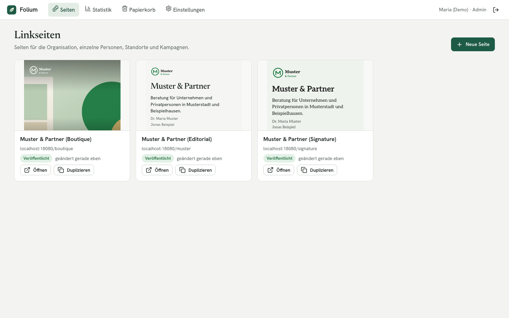

[← Handbuch](README.md) · [Weiter: 2 — Erste Schritte](02-erste-schritte.md)

# 1 — Was ist Folium?

Folium erstellt **Linkseiten** für Organisationen, etwa Kanzleien, Praxen, Unternehmen, Vereine oder Verwaltungen: eine schlichte, schnelle Seite mit den wichtigsten Wegen zu Ihnen, etwa „Anrufen“, „Termin anfragen“, Leistungen, Standorte und Links zur Homepage. Solche Seiten verlinkt man im Instagram-Profil, auf Visitenkarten, in der E-Mail-Signatur oder per QR-Code auf Flyern. Folium läuft auf Ihrem eigenen Server, ohne Cloud-Dienst und ohne Tracking durch Dritte.

*Folium* ist lateinisch für **Blatt**. Eine Linkseite ist ein einzelnes Blatt, auf dem alles Wichtige steht.

## Wofür man Folium braucht

- **Ein Link für alles.** Instagram und andere Netzwerke erlauben im Profil oft nur einen Link. Die Linkseite bündelt Telefon, Termin, E-Mail, Leistungen und Standorte dahinter.
- **Eine Seite je Zweck.** Eine Seite für die Organisation, eine je Person, eine je Standort, eine für eine Kampagne. Jede hat ihre eigene Adresse, etwa `links.example.com/muster`.
- **Änderungen ohne Agentur.** Sprechzeiten, Telefonnummern oder ein neuer Ratgeber-Link sind in wenigen Minuten geändert. Gedruckte QR-Codes zeigen weiter auf dieselbe Adresse.
- **Wissen, was genutzt wird.** Folium zählt Aufrufe und Klicks als Tagessummen, ohne Besucher zu verfolgen ([Kapitel 8](08-statistik.md)).

## Grundbegriffe

| Begriff | Bedeutung | Beispiel |
| --- | --- | --- |
| **Seite** (Linkseite) | Eine öffentliche Seite mit Kopf, Einträgen und Pflichtlinks | „Muster Instagram“ |
| **Name** | Interner Name der Seite in der Verwaltung; Besucher sehen ihn nicht | „Muster & Partner (Editorial)“ |
| **Adresse** | Der Teil hinter dem Schrägstrich der öffentlichen Adresse | `muster` → `https://links.example.com/muster` |
| **Kopf** | Oberer Teil der Seite: Name der Organisation oder Person, Kurzbeschreibung, persönliche Angaben, Logo, Bilder | |
| **Eintrag** | Ein Baustein der Seite: Hauptaktion, Link, Überschrift, Standort, Kontakt, Social Media oder Text | „Unsere Leistungen“ |
| **Hauptaktion** | Ein großer Knopf wie „Anrufen“, „E-Mail schreiben“ oder „Termin anfragen“ | „Anrufen: 030 123 456 70“ |
| **Entwurf** | Der Stand, an dem Sie arbeiten. Er wird automatisch gespeichert und ist für Besucher unsichtbar | |
| **Veröffentlichte Version** | Der Stand, den Besucher sehen. Jede Veröffentlichung erzeugt eine neue, nummerierte Version | „Version 3“ |
| **Design** | Farben, Schriften, Knopfformen und Aufbau einer Seite | |
| **Designrichtung** | Eine fertige Voreinstellung für das Design; Folium bringt drei mit | „Editorial“ |
| **Quelle** | Woher ein Besuch kam, gekennzeichnet durch `?src=…` an der Adresse | `?src=qr`, `?src=instagram` |

## Der Ablauf in sieben Schritten

1. **Anlegen:** Name, Adresse, Inhaltsvorlage und Designrichtung wählen ([Kapitel 3](03-seiten-bearbeiten.md)).
2. **Bearbeiten:** Kopf ausfüllen, Einträge hinzufügen, sortieren, ausblenden oder zeitlich steuern. Folium speichert dabei automatisch.
3. **Design:** Eine der drei Designrichtungen nehmen und bei Bedarf anpassen ([Kapitel 5](05-design.md)) oder ein Design aus der Homepage ableiten lassen ([Kapitel 6](06-design-aus-homepage.md)).
4. **Vorschau:** Rechts neben dem Editor sehen Sie die Seite so, wie Besucher sie sehen werden, wahlweise als Smartphone oder Desktop.
5. **Veröffentlichen:** Folium zeigt, was sich geändert hat, prüft die Pflichtlinks und warnt bei schwachem Kontrast ([Kapitel 4](04-veroeffentlichen-und-versionen.md)).
6. **Teilen:** Adresse kopieren, QR-Code herunterladen, bei Bedarf einen Kurzlink über Filum anlegen ([Kapitel 7](07-teilen.md)).
7. **Auswerten:** Aufrufe, Klicks je Eintrag und Quellen ansehen ([Kapitel 8](08-statistik.md)).

Solange Sie nicht veröffentlichen, ändert sich für Besucher nichts. Sie können also in Ruhe ausprobieren.

## Rollen

Jedes Konto hat eine von drei Rollen. Folium prüft die Rechte auf dem Server, nicht nur in der Oberfläche. Ihre eigene Rolle steht oben rechts neben Ihrem Namen.

| Rolle | Darf |
| --- | --- |
| **Ansehen** | Seiten, Vorschau, Versionen, Papierkorb und Statistik ansehen, QR-Codes und Statistik-Tabellen herunterladen. Ändern kann diese Rolle nichts. |
| **Redaktion** | Zusätzlich: Seiten anlegen, bearbeiten, veröffentlichen, duplizieren, löschen und wiederherstellen, Bilder und Schriften hochladen, „Design aus Homepage übernehmen“ nutzen, Kurzlinks in Filum und Codes in Tessera anlegen, Seiten exportieren. |
| **Admin** | Zusätzlich: Konten verwalten, allgemeine Einstellungen speichern, Domains eintragen, Sicherungen und Import, KI-Verbindung prüfen. |

Wie Konten angelegt und Rollen vergeben werden, steht in [Kapitel 10](10-konten-und-rollen.md).

## Datenschutz-Prinzip

Folium zählt **Aufrufe, keine Personen**. Die öffentlichen Seiten setzen keine Cookies, laden nichts von fremden Servern und speichern keine IP-Adressen, Geräteangaben oder Besucherkennungen. Gespeichert werden nur Tagessummen, etwa „Seite Muster, 14. November, Quelle QR-Code: 23 Aufrufe“. Die Statistik lässt sich in den Einstellungen ganz abschalten. Einzelheiten und ein Textbaustein für die Datenschutzerklärung stehen in [Kapitel 12](12-datenschutz.md).

Für „Design aus Homepage übernehmen“ sendet Folium nur Angaben über die öffentliche Homepage und die Art der Einträge Ihrer Linkseite an die KI, nie weitere Inhalte und keine personenbezogenen Daten Ihrer Besucher. Bevor etwas gesendet wird, zeigt Folium genau an, was übertragen würde ([Kapitel 6](06-design-aus-homepage.md)).

## Die Produktfamilie: Filum, Tessera, Folium

Folium gehört zu einer Familie von drei selbst gehosteten Werkzeugen, die zusammenarbeiten, aber jeweils allein funktionieren:

| Werkzeug | Bedeutung | Aufgabe |
| --- | --- | --- |
| **Filum** | lateinisch „Faden“ | Kurzlinks, z. B. `go.example.com/insta` |
| **Tessera** | lateinisch „Mosaiksteinchen“ | QR-Codes gestalten, mit Logo, Rahmen und Druckvorschau |
| **Folium** | lateinisch „Blatt“ | Linkseiten |

Ist Filum oder Tessera angebunden, erscheinen im Bereich **Teilen** zusätzliche Knöpfe. Folium nutzt dafür die vorhandenen Schnittstellen der beiden Programme und verändert sie nicht ([Kapitel 7](07-teilen.md)).

## Wer was liest

| Leserin oder Leser | Kapitel |
| --- | --- |
| Alle, die Linkseiten pflegen | 1–8 |
| Admins | 9–12 |
| IT | 13–23 |

---

[← Handbuch](README.md) · [Weiter: 2 — Erste Schritte](02-erste-schritte.md)
