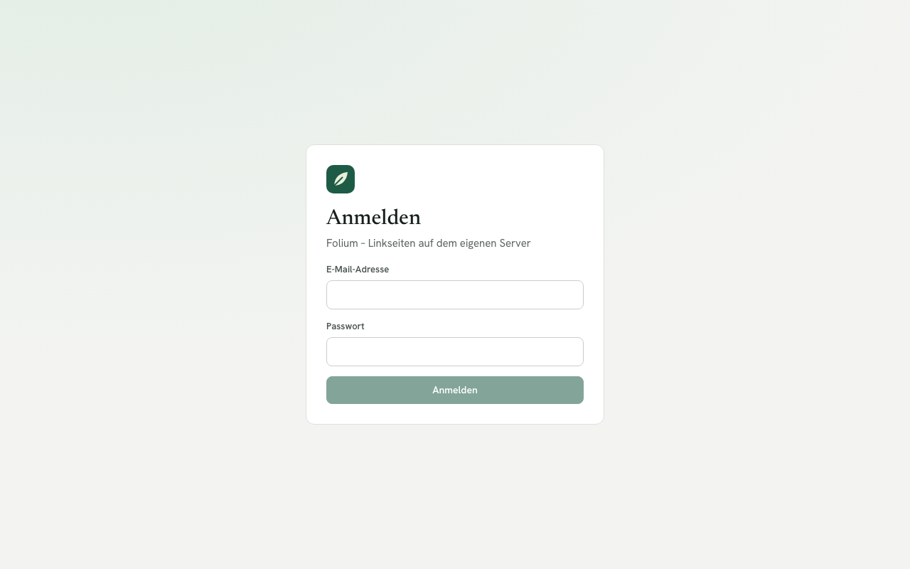
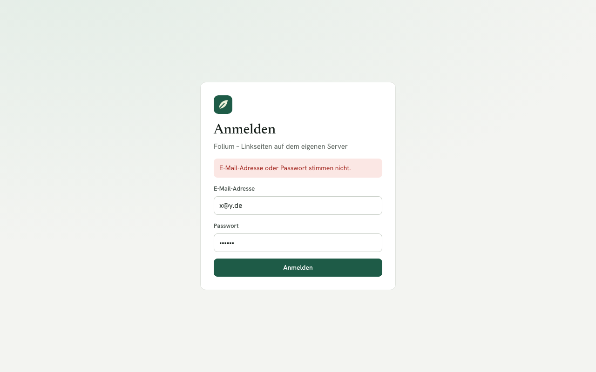
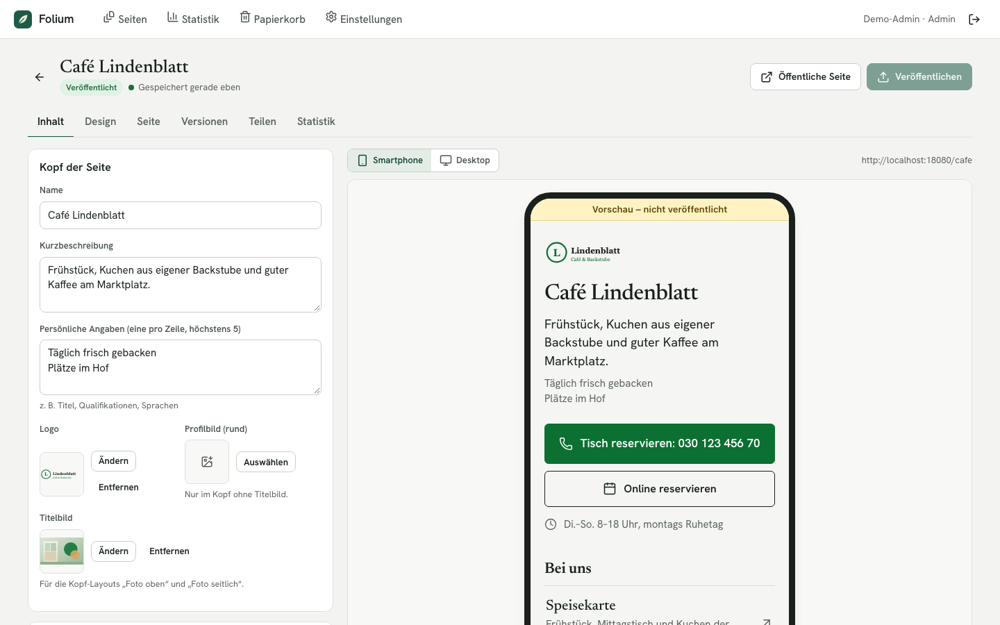

[← Handbuch](README.md) · [Weiter: 3 — Seiten bearbeiten](03-seiten-bearbeiten.md)

# 2 — Erste Schritte

## Anmelden

Öffnen Sie die Verwaltung von Folium im Browser. Die Adresse nennt Ihnen die IT. Die Verwaltung läuft getrennt von den öffentlichen Linkseiten und ist unter deren Adresse nicht erreichbar; in der empfohlenen Einrichtung erreichen Sie sie nur im internen Netz Ihrer Organisation oder über VPN ([Kapitel 14](14-reverse-proxy.md)).

1. **E-Mail-Adresse** und **Passwort** eingeben.
2. Auf **Anmelden** klicken.

Ist die Anmeldung über das zentrale Konto Ihrer Organisation (etwa authentik) eingerichtet, steht darunter ein zusätzlicher Knopf, zum Beispiel **Mit authentik anmelden**. Hat die IT die Anmeldung mit Passwort abgeschaltet, sehen Sie nur diesen Knopf ([Kapitel 16](16-anmeldung-oidc.md)).

Die Anmeldung gilt 14 Tage. Mit dem Symbol ganz rechts oben (**Abmelden**) melden Sie sich vorher ab.

### Wenn die Anmeldung nicht klappt

| Meldung | Bedeutung |
| --- | --- |
| *E-Mail-Adresse oder Passwort stimmen nicht.* | Tippfehler oder falsches Passwort. Folium sagt bewusst nicht, welches von beiden falsch ist. |
| *Zu viele fehlgeschlagene Anmeldungen. Bitte in … Minuten erneut versuchen.* | Nach 5 Fehlversuchen innerhalb von 15 Minuten ist die Anmeldung für diese E-Mail-Adresse 15 Minuten gesperrt. |
| *Die Anmeldung mit Passwort ist abgeschaltet.* | Bitte den Knopf für die Anmeldung über das zentrale Konto verwenden. |
| *Der Server ist nicht erreichbar. Bitte später erneut versuchen.* | Folium läuft gerade nicht oder das Netz ist getrennt. Bitte die IT informieren. |

Passwort vergessen? Die IT erzeugt auf dem Server ein neues Passwort für Ihr Konto ([Kapitel 10](10-konten-und-rollen.md)). In der Oberfläche gibt es dafür keinen eigenen Knopf.

## Ersteinrichtung mit Einrichtungscode

Beim allerersten Start gibt es noch kein Konto. Statt der Anmeldung erscheint dann **Folium einrichten**. Das erledigt in der Regel die IT oder die Person, die Admin werden soll.

1. Den **Einrichtungscode** besorgen. Folium schreibt ihn beim Start ins Serverprotokoll; die IT liest ihn mit `docker compose logs folium` ab. Er hat die Form `123-456-789`.
2. Die Felder ausfüllen:

   | Feld | Hinweis |
   | --- | --- |
   | **Einrichtungscode** | genau wie im Protokoll |
   | **Ihr Name** | erscheint oben rechts und im Verlauf der Versionen; leer bleibt „Admin“ |
   | **E-Mail-Adresse** | Ihre Anmeldung |
   | **Passwort** | mindestens 12 Zeichen |

3. Auf **Konto anlegen** klicken. Sie sind danach sofort als **Admin** angemeldet.

Der Code gilt nur einmal. Ist bereits ein Konto vorhanden, meldet Folium *Die Einrichtung ist bereits abgeschlossen.* Bei falschem Code erscheint *Der Einrichtungscode stimmt nicht. Er steht im Serverprotokoll.*

Danach als Erstes **Einstellungen → Allgemein** öffnen und die Adressen von **Impressum**, **Datenschutzerklärung** und **Homepage** eintragen ([Kapitel 11](11-einstellungen.md)). Nach der Installation sind diese Felder **leer**. Folium übernimmt sie beim Anlegen in jede neue Seite:

- **Ohne Impressum und Datenschutzerklärung lässt sich keine Seite veröffentlichen.** Der Dialog **Veröffentlichen** meldet dann *Impressum und Datenschutzerklärung fehlen. Bitte im Bereich „Seite“ eintragen.* und der Knopf **Jetzt veröffentlichen** bleibt gesperrt.
- Die Werte werden nur beim **Anlegen** übernommen. Seiten, die Sie anlegen, bevor die Einstellungen ausgefüllt sind, bekommen die Links nicht nachträglich; tragen Sie sie dort im Reiter **Seite** von Hand ein.
- Ohne **Homepage** zeigen die Links der Inhaltsvorlagen auf den Platzhalter `https://www.example.com`, und „Design aus Homepage übernehmen“ hat keine vorausgefüllte Adresse.

## Aufbau der Oberfläche

Oben steht die Hauptnavigation:

| Bereich | Inhalt |
| --- | --- |
| **Seiten** | Übersicht „Linkseiten“ mit einer Karte je Seite und dem Knopf **Neue Seite** |
| **Statistik** | Aufrufe und Klicks aller Seiten ([Kapitel 8](08-statistik.md)) |
| **Papierkorb** | Gelöschte Seiten, die sich noch wiederherstellen lassen ([Kapitel 4](04-veroeffentlichen-und-versionen.md#papierkorb)) |
| **Einstellungen** | Allgemein, Domains, Konten, KI und Verbindungen, Sicherung und Export; welche Reiter Sie sehen, hängt von Ihrer Rolle ab ([Kapitel 11](11-einstellungen.md)) |

Rechts oben stehen Ihr Name, Ihre Rolle (Admin, Redaktion oder Ansehen) und der Knopf zum Abmelden.

### Die Übersicht „Linkseiten“

Jede Seite erscheint als Karte mit einer kleinen Vorschau des Entwurfs, dem Namen, der öffentlichen Adresse und einem Status:

| Status | Bedeutung |
| --- | --- |
| **Nie veröffentlicht** | Die Seite existiert nur als Entwurf; unter ihrer Adresse findet ein Besucher nichts. |
| **Unveröffentlichte Änderungen** | Es gibt eine öffentliche Fassung, der Entwurf weicht aber davon ab. |
| **Veröffentlicht** | Entwurf und öffentliche Fassung sind gleich. |

Darunter steht, wann der Entwurf zuletzt geändert wurde, sowie die Knöpfe **Öffnen** (öffentliche Seite in neuem Tab, nur wenn veröffentlicht) und **Duplizieren**. Ein Klick auf den Namen öffnet den Editor.

### Der Editor einer Seite

- Oben: Pfeil **Zurück zur Übersicht**, Name der Seite, Status und Speicheranzeige (etwa *Gespeichert vor 3 Min.*). Rechts **Öffentliche Seite** (wenn veröffentlicht), gegebenenfalls **Änderungen verwerfen** und **Veröffentlichen**.
- Reiter: **Inhalt**, **Design**, **Seite**, **Versionen**, **Teilen**, **Statistik**.
- In den Reitern Inhalt, Design und Seite steht rechts die **Vorschau** mit dem Umschalter **Smartphone** / **Desktop**.

Mit der Rolle **Ansehen** sind alle Felder gesperrt und die Knöpfe zum Ändern fehlen.

## Die erste Seite in wenigen Minuten

1. **Seiten → Neue Seite** klicken.
2. **Name (nur intern)** eingeben, etwa „Café Instagram“. Folium schlägt daraus die **Adresse** vor (`cafe-instagram`); Sie können sie überschreiben, zum Beispiel mit `instagram`.
3. Unter **Inhalt** die Vorlage **Organisation** lassen. Sie bringt Telefon, Termin, E-Mail, Öffnungszeiten, Angebot, zwei Standorte und Links zur Homepage mit, gefüllt mit erfundenen Beispieldaten („Muster & Partner“, Musterstadt), die Sie durch Ihre eigenen ersetzen.
4. Unter **Design** **Editorial** lassen und **Seite anlegen** klicken.
5. Im Reiter **Inhalt** Kopf und Einträge prüfen. Was nicht passt, ändern Sie direkt; ein Klick auf einen Eintrag öffnet seine Felder unterhalb der Liste.
6. Im Reiter **Seite** prüfen, ob **Impressum** und **Datenschutzerklärung** stimmen. Folium übernimmt sie aus den Einstellungen; sind sie dort noch leer, tragen Sie sie hier ein, sonst lässt sich die Seite nicht veröffentlichen.
7. Rechts in der Vorschau zwischen **Smartphone** und **Desktop** wechseln und alles durchsehen.
8. **Veröffentlichen** klicken, die Änderungsübersicht lesen, optional eine Notiz eintragen, **Jetzt veröffentlichen**.
9. In der Meldung unten auf **Teilen** klicken. Dort kopieren Sie die Adresse oder laden den QR-Code herunter.

> **Gut zu wissen:** Sie müssen nie auf „Speichern“ drücken. Jede Änderung im Inhalt und im Design wird nach weniger als einer Sekunde automatisch als Entwurf gespeichert. Öffentlich wird sie erst mit **Veröffentlichen**.

---

[← Handbuch](README.md) · [Weiter: 3 — Seiten bearbeiten](03-seiten-bearbeiten.md)
