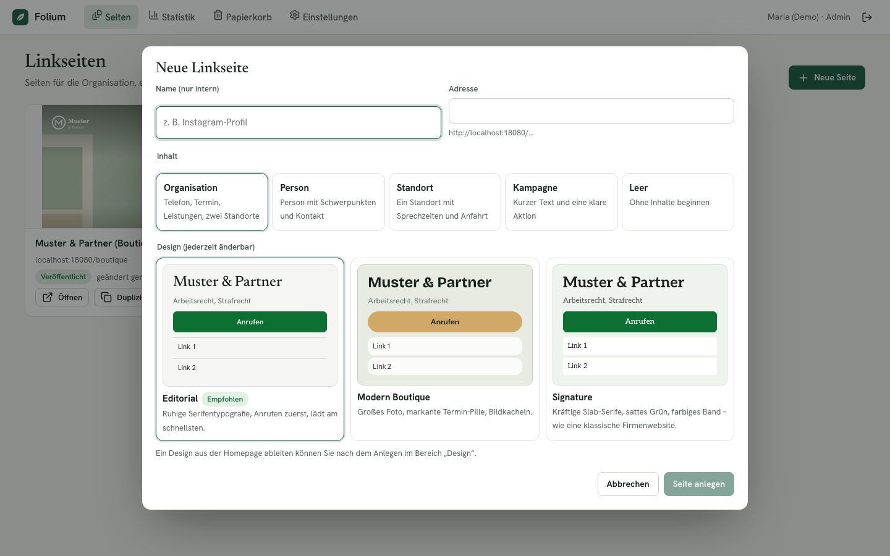

[← Handbuch](README.md) · [Weiter: 4 — Veröffentlichen und Versionen](04-veroeffentlichen-und-versionen.md)

# 3 — Seiten bearbeiten

## Neue Seite anlegen

**Seiten → Neue Seite** öffnet den Dialog **Neue Linkseite**.

| Feld | Bedeutung |
| --- | --- |
| **Name (nur intern)** | Erscheint nur in der Verwaltung, z. B. „Muster Instagram“. Höchstens 120 Zeichen. |
| **Adresse** | Teil hinter dem Schrägstrich der öffentlichen Adresse. Darunter steht die vollständige Adresse zur Kontrolle. |
| **Inhalt** | Inhaltsvorlage, siehe unten |
| **Design (jederzeit änderbar)** | Eine der drei Designrichtungen; vorausgewählt und als **Empfohlen** markiert ist **Editorial** ([Kapitel 5](05-design.md)) |

**Seite anlegen** öffnet danach direkt den Editor. Die neue Seite ist noch nicht öffentlich.

### Regeln für die Adresse

Solange Sie das Feld **Adresse** nicht selbst ändern, bildet Folium sie aus dem Namen. Folium wandelt jede Eingabe so um:

- Großbuchstaben werden klein, Umlaute werden umschrieben (ä → ae, ö → oe, ü → ue, ß → ss).
- Alles außer Buchstaben a–z und Ziffern wird zu einem Bindestrich.
- Mindestens 2, höchstens 60 Zeichen.
- Reserviert und daher nicht möglich: `c`, `f`, `qr`, `api`, `assets`, `fonts`, `vorschau`, `healthz`, `robots.txt`, `favicon.ico`.
- Jede Adresse gibt es nur einmal. Auch Seiten im Papierkorb behalten ihre Adresse; Folium meldet dann *Die Adresse „…“ gehört zu einer Seite im Papierkorb.*

### Die Inhaltsvorlagen

| Vorlage | Bringt mit |
| --- | --- |
| **Organisation** | Kopf „Muster & Partner“ mit zwei Personen (Dr. Maria Muster, Jonas Beispiel), Hauptaktionen Anrufen, Termin anfragen, E-Mail schreiben, Sprechzeiten, Abschnitt „Wobei wir helfen“ mit vier Links (Leistungen, Erstberatung, Häufige Fragen, Kosten), Abschnitt „Standorte“ (Musterstadt, Beispielhausen), Abschnitt „Mehr von uns“ (Über uns, Aktuelles) |
| **Person** | Kopf „Dr. Maria Muster“ mit Funktion, Anrufen, E-Mail, Abschnitt „Schwerpunkte“ mit zwei Links, Standort Musterstadt |
| **Standort** | Kopf „Muster & Partner in Beispielhausen“, Anrufen, Termin anfragen, Sprechzeiten, Standort Beispielhausen, Link „Alle Standorte“ |
| **Kampagne** | Kurzer Text, Termin anfragen, Anrufen, Link „Mehr erfahren“ |
| **Leer** | Nur der Name als Kopf, keine Einträge |

Alle Vorlagen übernehmen die Adressen von Impressum und Datenschutzerklärung aus den Einstellungen; sind diese dort leer, bleiben sie auch in der neuen Seite leer, und die Seite lässt sich erst veröffentlichen, wenn Sie sie im Reiter **Seite** eintragen ([Kapitel 2](02-erste-schritte.md#ersteinrichtung-mit-einrichtungscode)). Die Namen, Adressen, Telefonnummer (030 123 456 70) und E-Mail-Adresse (info@example.com) in den Vorlagen sind **erfundene Beispieldaten**. Die Links zeigen auf Unterseiten der Homepage aus den Einstellungen (etwa `/leistungen/`), ohne eingetragene Homepage auf `https://www.example.com`. Ersetzen Sie alles vor dem ersten Veröffentlichen durch Ihre eigenen Angaben.

> **Gut zu wissen:** In den Einstellungen gibt es das Feld **Standard-Designrichtung**. Im Dialog „Neue Linkseite“ ist trotzdem immer Editorial vorausgewählt. Wählen Sie die gewünschte Richtung dort von Hand.

## Der Kopf der Seite

Im Reiter **Inhalt** steht oben der Bereich **Kopf der Seite**.

| Feld | Hinweis |
| --- | --- |
| **Name** | Groß oben auf der Seite, z. B. „Muster & Partner“. Pflicht, höchstens 80 Zeichen. Er steht auch im Seitenfuß („© …“) und im Browser-Tab. |
| **Kurzbeschreibung** | Ein bis zwei Sätze, höchstens 200 Zeichen |
| **Persönliche Angaben** | Eine Angabe pro Zeile, höchstens 5 Zeilen mit je 120 Zeichen, z. B. Namen, Titel, Qualifikationen oder Sprachen |
| **Logo** | Über dem Namen; Größe im Design einstellbar |
| **Profilbild (rund)** | Erscheint nur, wenn der Kopf ohne Titelbild dargestellt wird |
| **Titelbild** | Für die Kopf-Layouts „Foto oben“ und „Foto seitlich“ ([Kapitel 5](05-design.md)). Ohne Titelbild zeigt Folium immer den reinen Textkopf. |

Hauptaktionen, die ganz am Anfang der Eintragsliste stehen, zeigt Folium im Kopf direkt unter den persönlichen Angaben, ebenso einen Kontakt-Eintrag, der unmittelbar auf sie folgt. Die erste Hauptaktion wird am stärksten hervorgehoben.

## Einträge hinzufügen

Unter der Liste **Einträge** stehen sieben Knöpfe, einer je Eintragsart. Ein neuer Eintrag landet direkt unter dem gerade ausgewählten Eintrag, sonst am Ende. Er ist sofort ausgewählt, seine Felder erscheinen unterhalb der Liste unter **… bearbeiten**. Eine Seite kann bis zu 100 Einträge haben.

### Die Eintragsarten und ihre Felder

| Eintragsart | Felder | Auf der Seite |
| --- | --- | --- |
| **Hauptaktion** | **Art**: Anrufen, E-Mail schreiben, Termin vereinbaren (Link zum Buchungssystem), Kontakt aufnehmen (Link zum Formular). **Beschriftung** (Pflicht, höchstens 60 Zeichen). Je nach Art **Telefonnummer**, **E-Mail-Adresse** oder **Adresse (URL)**. | Großer Knopf mit Symbol |
| **Link** | **Titel** (Pflicht, 120 Zeichen), **Beschreibung (optional)** (240 Zeichen), **Ziel** (`https://`, `http://`, `tel:` oder `mailto:`), **Symbol** (Automatisch oder eines von 22 Symbolen), **Bild (optional)** | Zeile, Karte oder Bildkachel, je nach Design |
| **Überschrift** | **Überschrift** (80 Zeichen) | Beginnt einen neuen Abschnitt; alle folgenden Einträge gehören dazu |
| **Standort** | **Name**, **Rolle** (z. B. Hauptsitz), **Adresse** (mehrzeilig), **Hinweis (optional)**, **Routenlink (optional)**, nur `https://` | Adressblock; mit Routenlink zusätzlich „Route planen“ |
| **Kontakt** | **Telefon**, **E-Mail**, **Sprechzeiten** | Kleine Zeilen mit Symbol; Telefon und E-Mail sind anklickbar |
| **Social Media** | Bis zu 10 Profile, je **Netzwerk** (LinkedIn, Instagram, Facebook, XING, YouTube, X, TikTok, Mastodon, WhatsApp, Website) und **Profil-Adresse** | Reihe von Profil-Links |
| **Text** | **Text** (1000 Zeichen, reiner Text, Leerzeile = neuer Absatz) | Fließtext |

Telefonnummern dürfen Leerzeichen, Klammern, Schrägstriche, Punkte und Bindestriche enthalten; Folium entfernt sie im Link. Die Symbole heißen in der Auswahl technisch: `phone`, `mail`, `calendar`, `map-pin`, `scale`, `gavel`, `briefcase`, `file-text`, `book-open`, `globe`, `users`, `message-circle`, `download`, `info`, `shield-check`, `link`, `star`, `video`, `newspaper`, `clock`, `building`, `euro`. Bei **Automatisch** wählt Folium ein Symbol nach der Art des Ziels (Webadresse, Telefon oder E-Mail).

Fehlerhafte Angaben zeigt Folium rot unter dem Feld, zum Beispiel *Bitte eine vollständige Adresse mit https:// angeben.*, *Bitte eine gültige Telefonnummer angeben.* oder *Adressen mit Zugangsdaten sind nicht erlaubt.*

> **Gut zu wissen:** Ein neuer Link oder eine neue Hauptaktion beginnt mit dem Platzhalter `https://`. Bis dort eine vollständige Adresse steht, kann Folium den Entwurf nicht speichern und zeigt *Nicht gespeichert – erneut versuchen*. Sobald die Adresse gültig ist, speichert Folium wieder von selbst.

## Sortieren

Jede Zeile der Eintragsliste hat links einen Griff und rechts Knöpfe.

- **Mit der Maus:** am Griff (sechs Punkte) ziehen und an der neuen Stelle loslassen.
- **Mit der Tastatur:** den Griff mit der Tab-Taste ansteuern, **Leertaste** drücken, mit den **Pfeiltasten** verschieben, mit der **Leertaste** ablegen. **Escape** bricht ab. Bildschirmleser sagen die jeweilige Position an.
- **Mit Knöpfen:** **Nach oben** und **Nach unten** (Pfeilsymbole) verschieben um eine Position.

## Ausblenden

Das Augensymbol in der Zeile blendet einen Eintrag aus oder wieder ein. Ausgeblendete Einträge bleiben im Entwurf, erscheinen aber weder in der Vorschau noch auf der veröffentlichten Seite. In der Liste steht dann *Ausgeblendet*. Denselben Schalter gibt es in den Feldern des Eintrags als **Auf der Seite anzeigen**.

## Zeitplan: sichtbar ab und bis

Unter den Feldern jedes Eintrags steht der aufklappbare Bereich **Sichtbarkeit und Zeitplan**.

| Feld | Bedeutung |
| --- | --- |
| **Sichtbar ab** | Datum und Uhrzeit, ab der der Eintrag erscheint. Leer = sofort. |
| **Sichtbar bis** | Datum und Uhrzeit, bis zu der der Eintrag erscheint, einschließlich dieser Minute. Leer = unbegrenzt. |

Beispiel: „Sichtbar bis 24.12., 13:59“ zeigt den Eintrag bis 13:59:59 Uhr. Die Zeiten gelten in der Zeitzone, die die IT eingestellt hat (`APP_TIMEZONE`, Standard Europe/Berlin). In der Liste tragen zeitgesteuerte Einträge den Hinweis *Zeitgesteuert* und ein Kalendersymbol.

Der Zeitplan selbst wird erst mit dem Veröffentlichen wirksam. Danach blendet Folium den Eintrag zum eingestellten Zeitpunkt von selbst ein oder aus, ohne dass jemand erneut veröffentlichen muss.

> **Gut zu wissen:** Die Vorschau zeigt die Seite so, wie sie *jetzt* aussehen würde. Ein Eintrag mit „Sichtbar ab“ in der Zukunft fehlt deshalb auch in der Vorschau.

## Löschen und Rückgängig

Das Papierkorbsymbol in der Zeile löscht einen Eintrag sofort. Unten erscheint die Meldung *„…“ gelöscht.* mit dem Knopf **Rückgängig**; sie bleibt 10 Sekunden stehen. **Rückgängig** setzt den Eintrag an seine alte Stelle zurück. Danach holen Sie ihn nur noch über eine frühere Version zurück ([Kapitel 4](04-veroeffentlichen-und-versionen.md)).

Wie man eine ganze Seite löscht, steht in [Kapitel 4](04-veroeffentlichen-und-versionen.md#papierkorb).

## Automatisches Speichern

Jede Änderung im Inhalt oder Design speichert Folium knapp eine Sekunde nach der letzten Eingabe. Die Anzeige neben dem Status zeigt den Stand:

| Anzeige | Bedeutung |
| --- | --- |
| *Gespeichert vor …* | Alles ist gespeichert. |
| *Ungespeicherte Änderungen* | Folium wartet auf das Ende Ihrer Eingabe. |
| *Speichert …* | Der Entwurf wird gerade gespeichert. |
| *Nicht gespeichert – erneut versuchen* | Das Speichern ist gescheitert, etwa wegen einer ungültigen Angabe oder einer Netzstörung. Ein Klick versucht es erneut; der Grund steht im Tooltip. |

Wer die Seite mit ungespeicherten Änderungen verlässt oder den Tab schließt, bekommt vom Browser eine Warnung.

**Name und Adresse** der Seite (Reiter **Seite**) werden nicht automatisch gespeichert, sondern mit dem Knopf **Speichern** darunter. Ändern Sie die Adresse einer veröffentlichten Seite, gilt die neue Adresse sofort. Folium warnt: *Achtung: Die alte Adresse funktioniert danach nicht mehr. Gedruckte Links und QR-Codes zeigen dann ins Leere.*

### Wenn zwei Personen gleichzeitig bearbeiten

Folium merkt, wenn der Entwurf inzwischen an anderer Stelle gespeichert wurde, und öffnet den Dialog **Seite wurde an anderer Stelle geändert** mit dem Namen der anderen Person:

- **Neu laden (meine Änderungen verwerfen)** übernimmt den Stand der anderen Person.
- **Meine Fassung behalten** überschreibt die andere Änderung mit Ihrem Stand.

Eine Zusammenführung beider Fassungen gibt es nicht. Sprechen Sie sich im Zweifel kurz ab.

## Bilder hochladen

Ein Klick auf **Auswählen** oder **Ändern** bei Logo, Profilbild, Titelbild oder beim Bild eines Links öffnet **Bild auswählen**. Dort sehen Sie alle bisher hochgeladenen Bilder und können eines anklicken oder mit **Datei hochladen** ein neues hinzufügen. **Entfernen** löst das Bild nur vom Feld; die Datei bleibt in der Auswahl.

| Eigenschaft | Wert |
| --- | --- |
| Formate | JPEG, PNG, WebP, AVIF, SVG; GIF wird ebenfalls angenommen (nur das erste Bild einer Animation) |
| Größe | höchstens 5 MB je Datei |
| Verarbeitung | Fotos werden in mehreren Breiten bis höchstens 2400 Pixel als WebP gespeichert, ohne Metadaten wie Kamera oder Standort. SVG-Grafiken werden bereinigt. |
| Erkennung | nach dem Inhalt der Datei, nicht nach der Endung |

Lädt jemand dasselbe Bild zweimal hoch, legt Folium es nur einmal ab. Meldungen wie *Die Datei ist größer als 5 MB.* oder *Das Bild ließ sich nicht lesen. Bitte als JPEG, PNG oder WebP speichern und erneut hochladen.* nennen den Grund.

---

[← Handbuch](README.md) · [Weiter: 4 — Veröffentlichen und Versionen](04-veroeffentlichen-und-versionen.md)
