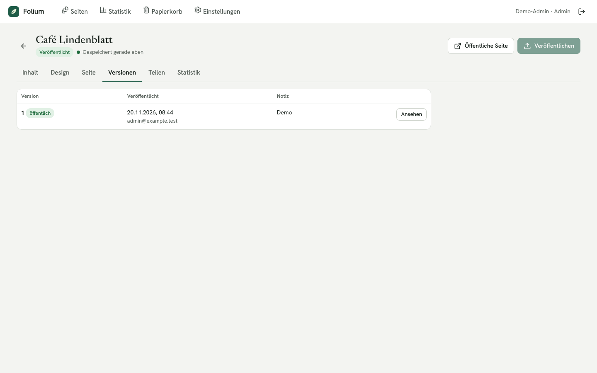
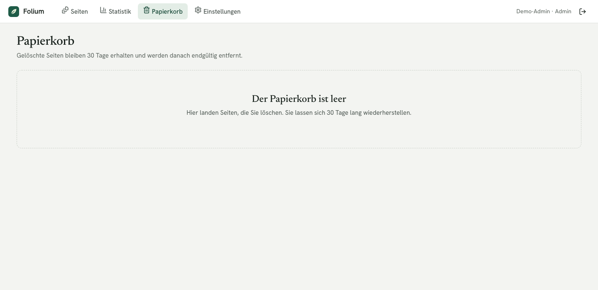

[← Handbuch](README.md) · [Weiter: 5 — Design](05-design.md)

# 4 — Veröffentlichen und Versionen

Folium trennt streng zwischen dem **Entwurf**, an dem Sie arbeiten, und der **veröffentlichten Version**, die Besucher sehen. Dieses Kapitel beschreibt den Weg vom einen zum anderen und zurück.

## Die Vorschau

In den Reitern **Inhalt**, **Design** und **Seite** steht rechts die Vorschau. Sie zeigt den aktuellen Entwurf, auch Änderungen, die noch nicht gespeichert sind, und nutzt dafür dieselbe Darstellung wie die öffentliche Seite.

- **Smartphone** zeigt die Seite in einem Telefonrahmen. So sehen die meisten Besucher sie.
- **Desktop** zeigt die Seite in 1280 Pixel Breite, verkleinert auf den verfügbaren Platz.
- Oben in der Vorschau steht *Vorschau – nicht veröffentlicht*; rechts daneben die künftige öffentliche Adresse.
- Links in der Vorschau öffnen sich in einem neuen Tab. Klicks in der Vorschau werden nicht gezählt.

Kann die Vorschau nicht aktualisiert werden, erscheint *Die Vorschau kann gerade nicht aktualisiert werden: …* mit dem Grund, meist einer ungültigen Angabe.

## Pflichtangaben und Suchmaschinen (Reiter „Seite“)

Vor dem ersten Veröffentlichen lohnt ein Blick in den Reiter **Seite**:

| Bereich | Felder |
| --- | --- |
| **Name und Adresse** | **Name (nur intern)**, **Adresse**, Knopf **Speichern** ([Kapitel 3](03-seiten-bearbeiten.md#automatisches-speichern)) |
| **Pflichtangaben** | **Impressum** und **Datenschutzerklärung**: Adressen der jeweiligen Seiten auf der Homepage. Ohne beide lässt sich nicht veröffentlichen. Sie erscheinen als Links im Fuß der Seite. |
| **Suchmaschinen und Teilen** | **Titel im Browser-Tab (optional)**, leer = Name aus dem Kopf. **Beschreibung (optional)**, leer = Kurzbeschreibung; sie erscheint auch in der Vorschau, wenn jemand den Link in einem Messenger teilt. **Nicht in Suchmaschinen aufnehmen (noindex)** |
| **Seite entfernen** | Knopf **In den Papierkorb**, siehe [Papierkorb](#papierkorb) |

## Veröffentlichen

Der Knopf **Veröffentlichen** oben rechts ist nur aktiv, wenn es Änderungen gegenüber der öffentlichen Fassung gibt. Ein Klick speichert zuerst noch offene Änderungen und öffnet dann den Dialog **Veröffentlichen**:

1. **Hinweise lesen.** Folium prüft vorab:

   | Prüfung | Art | Meldung |
   | --- | --- | --- |
   | Impressum und Datenschutzerklärung | **Pflicht**; ohne sie bleibt **Jetzt veröffentlichen** gesperrt | *Impressum und Datenschutzerklärung fehlen. Bitte im Bereich „Seite“ eintragen.* |
   | Kontrast der Farben | Warnung | *Geringer Kontrast: Text auf Hauptaktion (3,1:1), … Das erschwert das Lesen, besonders auf Smartphones im Freien.* |
   | Sichtbare Einträge | Warnung | *Die Seite enthält keine sichtbaren Einträge.* |
   | Name im Kopf | Pflicht (wird beim Absenden geprüft) | *Bitte einen Namen im Kopf der Seite eintragen.* |
   | Ziel bei eingeblendeten Links und Hauptaktionen | Pflicht (wird beim Absenden geprüft) | *Bei „…“ fehlt noch das Ziel. Bitte ergänzen oder den Eintrag ausblenden.* ([Kapitel 3](03-seiten-bearbeiten.md#einträge-ohne-ziel)) |

   Eine Kontrastwarnung hält Sie nicht auf. Besser ist es aber, im Reiter **Design** auf **Korrigieren** zu klicken ([Kapitel 5](05-design.md#kontrastprüfung-und-korrigieren)).

2. **Änderungen prüfen.** Unter *Änderungen gegenüber Version N* listet Folium jede Änderung mit einer Marke **Neu**, **Geändert** oder **Entfernt**: neue und gelöschte Einträge mit Titel, geänderte Einträge (mit dem Zusatz *eingeblendet*, *ausgeblendet* oder *Zeitplan*, wenn nur das geändert wurde), die *Reihenfolge der Einträge*, den *Kopf der Seite*, *Pflichtangaben oder Suchmaschinen-Einstellungen* und das *Design*. Bei der ersten Veröffentlichung steht dort *Erste Veröffentlichung dieser Seite*.
3. **Notiz zur Version (optional)** eintragen, etwa „Öffnungszeiten über die Feiertage“. Höchstens 300 Zeichen. Die Notiz erscheint später in der Liste der Versionen.
4. **Jetzt veröffentlichen** klicken.

Unten erscheint *Veröffentlicht als Version N.* mit dem Knopf **Teilen**, der direkt zum Reiter **Teilen** führt. Die Seite ist ab sofort unter ihrer Adresse erreichbar.

> **Gut zu wissen:** Browser dürfen eine Linkseite bis zu 60 Sekunden zwischenspeichern. Wer die Seite gerade geöffnet hatte, sieht die neue Fassung also spätestens nach einer Minute beim Neuladen.

## Versionen

Der Reiter **Versionen** listet jede Veröffentlichung, die neueste oben.

| Spalte | Inhalt |
| --- | --- |
| **Version** | Laufende Nummer; die aktuell öffentliche trägt die Marke **öffentlich** |
| **Veröffentlicht** | Datum, Uhrzeit und wer veröffentlicht hat |
| **Notiz** | Ihre Notiz aus dem Dialog, bei Wiederherstellungen automatisch „Wiederhergestellt aus Version N“ |

Je Zeile gibt es diese Knöpfe:

| Knopf | Wirkung |
| --- | --- |
| **Ansehen** | Zeigt die Version in einem Fenster, gekennzeichnet mit *Vorschau – Version N*. Ändert nichts. |
| **Wiederherstellen** | Macht die alte Version **sofort wieder öffentlich**, und zwar als neue Version mit der nächsten Nummer. Ihr Entwurf bleibt unverändert. Folium fragt vorher nach. |
| **In Entwurf laden** | Übernimmt die alte Version **nur in den Entwurf**. Öffentlich ändert sich nichts, bis Sie veröffentlichen. Folium fragt vorher nach. |

**Wiederherstellen** und **In Entwurf laden** fehlen bei der Version, die gerade öffentlich ist.

### Wiederherstellen oder In Entwurf laden?

- **Wiederherstellen** ist der Notausgang: Nach einer fehlerhaften Veröffentlichung ist mit einem Klick wieder der alte Stand online. Danach können Sie den Entwurf in Ruhe korrigieren.
- **In Entwurf laden** nutzen Sie, wenn Sie eine alte Fassung als Ausgangspunkt für neue Änderungen brauchen, etwa die Sommer-Öffnungszeiten oder das Festprogramm vom letzten Jahr.

> **Gut zu wissen:** **In Entwurf laden** ersetzt den bisherigen Entwurf vollständig. Die Rückfrage *Version N in den Entwurf laden?* weist darauf hin: *Der aktuelle Entwurf wird durch diese Version ersetzt. Öffentlich ändert sich nichts, bis Sie veröffentlichen. Den bisherigen Entwurf finden Sie danach nicht mehr unter „Versionen“.* Ungespeicherte oder unveröffentlichte Änderungen gehen dabei verloren; nur das bisherige Design landet unter **Frühere Entwurfsdesigns** ([Kapitel 5](05-design.md#frühere-entwurfsdesigns)).

## Änderungen verwerfen

Hat eine veröffentlichte Seite **Unveröffentlichte Änderungen**, erscheint oben der Knopf **Änderungen verwerfen**. Nach der Rückfrage *Änderungen verwerfen?* setzt Folium den Entwurf auf die zuletzt veröffentlichte Version zurück: *Entwurf auf die veröffentlichte Version zurückgesetzt.* Alle Änderungen seitdem sind weg. Bei einer Seite, die nie veröffentlicht wurde, gibt es nichts zum Zurücksetzen.

## Duplizieren

**Duplizieren** in der Übersicht „Linkseiten“ legt eine Kopie des **Entwurfs** an:

- Name mit dem Zusatz „(Kopie)“, Adresse mit dem Zusatz `-kopie` (bei weiteren Kopien `-kopie-2`, `-kopie-3` …).
- Die Kopie ist nie veröffentlicht und hat keine Versionen.
- Folium meldet *Kopie „…“ angelegt.* und öffnet sie im Editor.

Typischer Einsatz: aus der Seite der Organisation eine Seite für einen Standort, eine Person oder eine Aktion wie das Sommerfest ableiten. Passen Sie danach Name und Adresse im Reiter **Seite** an.

## Papierkorb

Eine Seite löschen Sie im Reiter **Seite** unter **Seite entfernen** mit **In den Papierkorb**. Nach der Rückfrage gilt:

- Die Seite ist **sofort nicht mehr öffentlich erreichbar**. Besucher sehen unter ihrer Adresse *Diese Seite gibt es nicht.*
- Die Meldung *Seite in den Papierkorb gelegt.* hat einen Knopf **Rückgängig**.
- Die Adresse bleibt für diese Seite reserviert, solange sie im Papierkorb liegt.

Unter **Papierkorb** in der Hauptnavigation stehen alle gelöschten Seiten mit Name, Adresse und Löschdatum. **Wiederherstellen** holt eine Seite zurück, mit Entwurf, allen Versionen und Statistik. War sie vorher veröffentlicht, ist sie danach sofort wieder öffentlich (*„…“ wiederhergestellt und wieder öffentlich.*).

Nach Ablauf der Frist löscht Folium Seiten endgültig, samt Versionen. Standard sind 30 Tage. Admins können die Frist unter **Einstellungen → Allgemein → Papierkorb leeren nach (Tagen)** zwischen 1 und 365 Tagen einstellen ([Kapitel 11](11-einstellungen.md)). Die Hinweistexte im Papierkorb und in der Rückfrage beim Löschen nennen die eingestellte Zahl Tage.

---

[← Handbuch](README.md) · [Weiter: 5 — Design](05-design.md)
