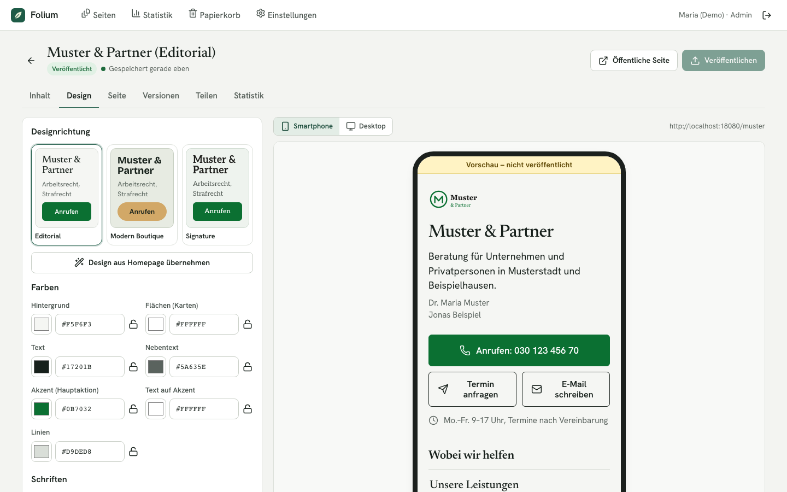
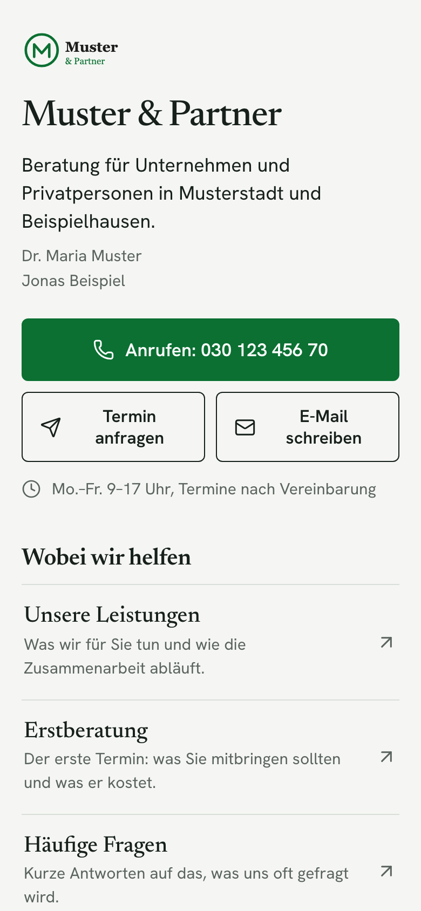
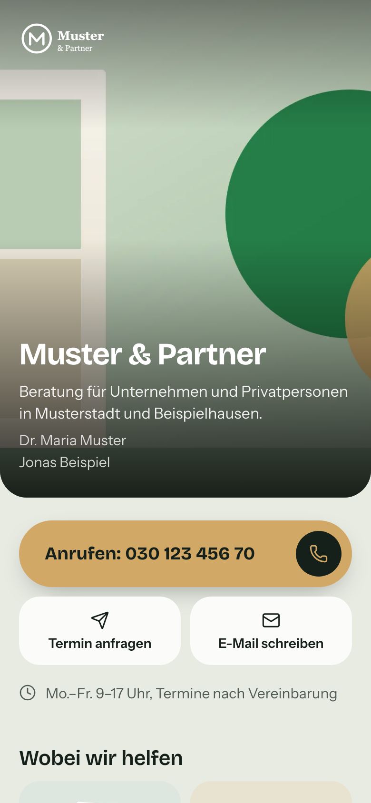
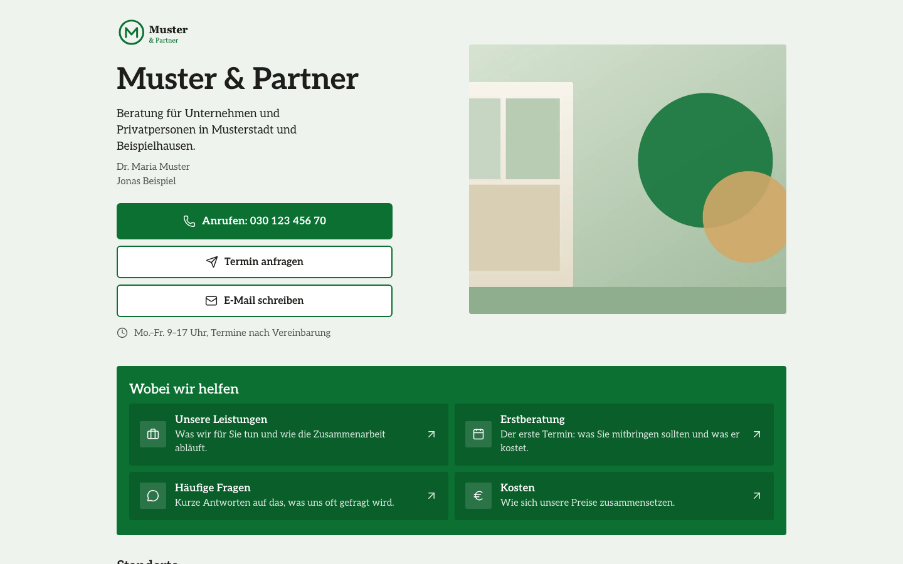

[← Handbuch](README.md) · [Weiter: 6 — Design aus Homepage übernehmen](06-design-aus-homepage.md)

# 5 — Design

Im Reiter **Design** legen Sie fest, wie eine Seite aussieht: Farben, Schriften, Knöpfe und Aufbau. Jede Änderung landet wie beim Inhalt automatisch im Entwurf und wird erst mit **Veröffentlichen** öffentlich. Die Vorschau rechts zeigt jede Änderung sofort.

## Die drei Designrichtungen

Oben im Reiter stehen drei Musterkarten. Ein Klick auf eine Karte setzt **alle** Designwerte auf diese Richtung zurück. Danach können Sie jede Einstellung einzeln ändern; Folium kennzeichnet das als *Eigene Anpassung. Ein Klick auf eine Richtung setzt alle Werte zurück.*

### Editorial (Standard)

*Ruhige Serifentypografie, Anrufen zuerst, lädt am schnellsten.* Die empfohlene Richtung für die meisten Seiten.

Schriften Newsreader (Überschriften) und Hanken Grotesk (Text), helles Papiergrau mit dunklem Grün als Akzent, leicht gerundete gefüllte Knöpfe, Links als Liste mit Trennlinien, Kopf als reiner Text.

### Modern Boutique

*Großes Foto, markante Termin-Pille, Bildkacheln.*

Schriften Bricolage Grotesque und Instrument Sans, Salbeigrün mit Goldakzent, pillenförmige Knöpfe, großzügige Abstände, Kopf mit großem Foto oben, Links als Bildkacheln. Die erste Hauptaktion ist eine große Pille, die beim Herunterscrollen unten am Bildschirmrand mitläuft.

### Signature

*Kräftige Slab-Serife, sattes Grün, farbiges Band – wie eine klassische Firmenwebsite.*

Schrift Aleo für alles, sattes Grün als Akzent, Kopf mit Foto seitlich und großem Logo, Links als Karten, der erste Linkabschnitt als grünes Band.

> **Gut zu wissen:** Die Kopf-Layouts mit Foto wirken nur, wenn im Reiter **Inhalt** ein **Titelbild** gesetzt ist. Ohne Titelbild zeigt jede Richtung den Kopf als reinen Text.

Weitere Bildschirmfotos liegen als `oeffentlich-*-desktop.png` und `oeffentlich-*-smartphone.png` im Ordner `docs/screenshots`.

## Alle Einstellungen

### Farben

Sieben Farben, jede mit Farbwähler und Eingabefeld für den Hexwert (`#RRGGBB`). Das Eingabefeld übernimmt nur vollständige, gültige Werte; einen halb getippten Wert setzt es beim Verlassen zurück.

| Farbe | Wofür |
| --- | --- |
| **Hintergrund** | Fläche der ganzen Seite |
| **Flächen (Karten)** | Hintergrund von Karten und Kacheln |
| **Text** | Haupttext |
| **Nebentext** | Beschreibungen, persönliche Angaben, Sprechzeiten |
| **Akzent (Hauptaktion)** | Füllung der Hauptaktion und Akzente |
| **Text auf Akzent** | Schrift auf der Hauptaktion |
| **Linien** | Trennlinien und Rahmen |

### Schriften

Zwei Auswahlfelder: **Überschriften** und **Fließtext**. Mitgeliefert sind zehn Schriften, alle unter der SIL Open Font License und direkt von Ihrem Server ausgeliefert:

| Schrift | Art | Beschreibung in Folium |
| --- | --- | --- |
| Newsreader | Serife | Ruhige Zeitungsserife mit optischen Größen |
| Source Serif 4 | Serife | Klassische Buchserife |
| Literata | Serife | Gut lesbare Leseschrift |
| Aleo | Serifenbetont | Kräftige, freundliche Slab-Serife |
| Zilla Slab | Serifenbetont | Kräftige Serifenbetonte |
| Hanken Grotesk | Grotesk | Klare, freundliche Grotesk |
| Instrument Sans | Grotesk | Moderne, schmale Grotesk |
| Bricolage Grotesque | Grotesk | Charaktervolle Überschriftenschrift |
| Public Sans | Grotesk | Neutrale Behördengrotesk |
| IBM Plex Sans | Grotesk | Technisch-sachliche Grotesk |

**Eigene Schrift hochladen …** am Ende der Liste öffnet **Schrift auswählen**. Erlaubt sind WOFF2, TTF und OTF bis 5 MB. Laden Sie nur Schriften hoch, deren Lizenz die Nutzung im Web erlaubt; Folium prüft das nicht. Eine hochgeladene Schrift erscheint danach in der Liste als **Eigene Schrift**.

### Formen und Aufbau

| Einstellung | Möglichkeiten |
| --- | --- |
| **Knopfform** | Eckig, Leicht gerundet, Rund, Pille |
| **Knopfstil** | Gefüllt, Umrandet |
| **Hauptaktion** | Knopf; Große Pille, mitlaufend (erscheint unten am Bildschirm, sobald der Knopf aus dem Bild gescrollt ist) |
| **Links als** | Liste, Karten, Bildkacheln. Als Kachel erscheinen nur Links mit eigenem Bild; die übrigen stehen darunter als Liste. |
| **Kopf** | Text, Foto oben, Foto seitlich (beide nur mit Titelbild) |
| **Logogröße** | Klein, Mittel, Groß |
| **Kartenstil** | Linie, Fläche, Ohne |
| **Rundung der Karten** | Schieberegler 0 bis 28 Pixel |
| **Abstände** | Kompakt, Normal, Großzügig |
| **Ersten Linkabschnitt als farbiges Band hervorheben** | Der erste Abschnitt mit Überschrift, der Links enthält, erhält eine farbige Fläche |

## Kontrastprüfung und Korrigieren

Folium prüft laufend fünf Farbpaare gegen den Mindestkontrast 4,5:1 (WCAG-Stufe AA für normalen Text):

- Text auf Hintergrund
- Text auf Flächen
- Nebentext auf Hintergrund
- Nebentext auf Flächen
- Text auf Hauptaktion

Reicht ein Paar nicht, erscheint über den Farben *Zu wenig Kontrast: … (mindestens 4,5:1).* und unter der betroffenen Textfarbe der gemessene Wert, etwa *Kontrast 3,1:1*. Der Knopf **Korrigieren** verschiebt jede zu schwache Textfarbe schrittweise Richtung Schwarz oder Weiß, bis 4,5:1 erreicht ist. Hintergrund- und Akzentfarbe bleiben dabei unverändert. Die Kontrastwarnung erscheint auch im Dialog **Veröffentlichen** ([Kapitel 4](04-veroeffentlichen-und-versionen.md#veröffentlichen)).

## Das Schloss: Werte festhalten

Neben den meisten Einstellungen steht ein Schloss-Symbol. Ein Klick hält den Wert **fest** (geschlossenes, grünes Schloss); ein weiterer Klick löst ihn. Festgehaltene Werte übernimmt „Design aus Homepage übernehmen“ unverändert in jede neue Variante ([Kapitel 6](06-design-aus-homepage.md#festgehaltene-werte)).

Festhalten lassen sich die sieben Farben, beide Schriften, Knopfform, Knopfstil, Hauptaktion, Link-Darstellung, Kopf-Layout, Kartenstil und Abstände. Logogröße, Rundung und das farbige Band haben kein Schloss.

> **Gut zu wissen:** Das Schloss wirkt nur auf KI-Vorschläge, nicht auf Ihre eigenen Änderungen und nicht auf einen Klick auf eine Designrichtung. Folium merkt sich die Schlösser nur, solange der Editor geöffnet ist; nach dem Neuladen sind alle wieder offen.

## Frühere Entwurfsdesigns

Jede gespeicherte Designänderung legt den vorherigen Stand ab. Unter den Einstellungen steht deshalb der aufklappbare Bereich **Frühere Entwurfsdesigns (N)**. Er zeigt die letzten zehn Stände mit Datum und Herkunft:

| Herkunft | Bedeutung |
| --- | --- |
| manuell | Stand vor einer eigenen Änderung, vor **In Entwurf laden** oder vor **Änderungen verwerfen** |
| KI-Vorschlag | Stand vor einer übernommenen KI-Variante |
| Wiederhergestellt | Stand vor einem **Zurückholen** |

**Zurückholen** setzt diesen Stand wieder als Entwurfsdesign ein. Folium bewahrt je Seite bis zu 50 frühere Stände auf. Da beim Ausprobieren viele kleine Zwischenstände entstehen, ist das Datum der beste Anhaltspunkt.

## Warum kein eigenes CSS?

Folium erlaubt bewusst kein eigenes CSS, HTML oder JavaScript. Ein Design besteht nur aus den geprüften Werten oben; der Server setzt daraus die Seite nach festen Vorlagen zusammen. Das hat drei Gründe:

- **Sicherheit.** Fremder Code auf einer Linkseite könnte Besucher ausspähen oder umleiten. Die öffentlichen Seiten laden deshalb nichts von fremden Servern und führen nur ein einziges, festes Skript aus ([Kapitel 20](20-sicherheit.md)).
- **Verlässlichkeit.** Jede Kombination der Einstellungen funktioniert auf Smartphone und Desktop, bleibt lesbar und lädt schnell.
- **Pflege.** Wer die Seite in einem Jahr ändert, findet dieselben Regler vor und muss keinen Code verstehen.

Was sich mit den Einstellungen nicht erreichen lässt, steht in [Kapitel 23](23-einschraenkungen.md).

---

[← Handbuch](README.md) · [Weiter: 6 — Design aus Homepage übernehmen](06-design-aus-homepage.md)
