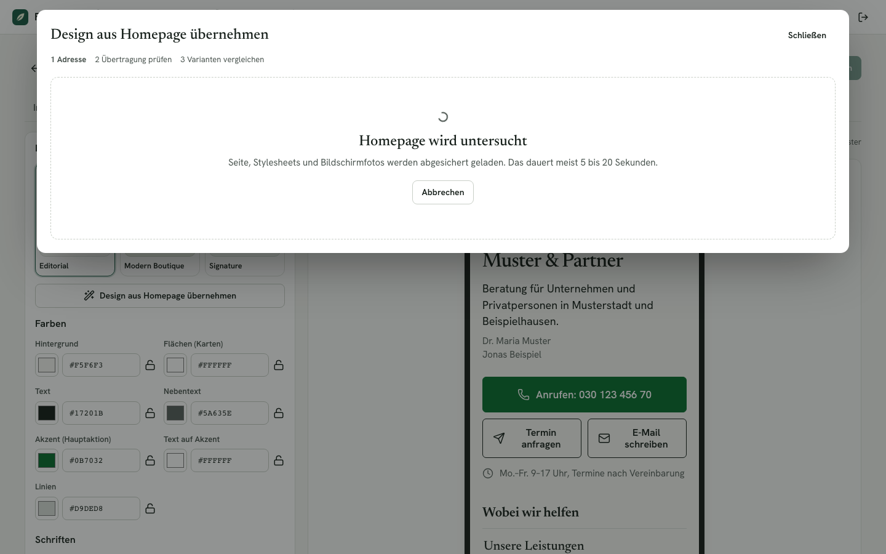
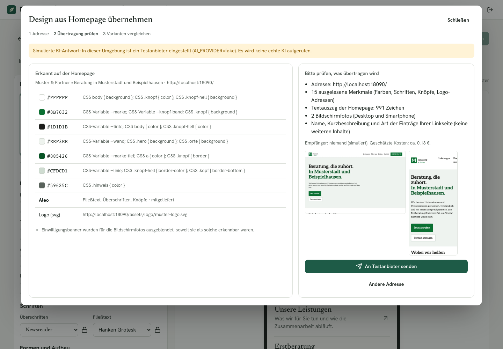
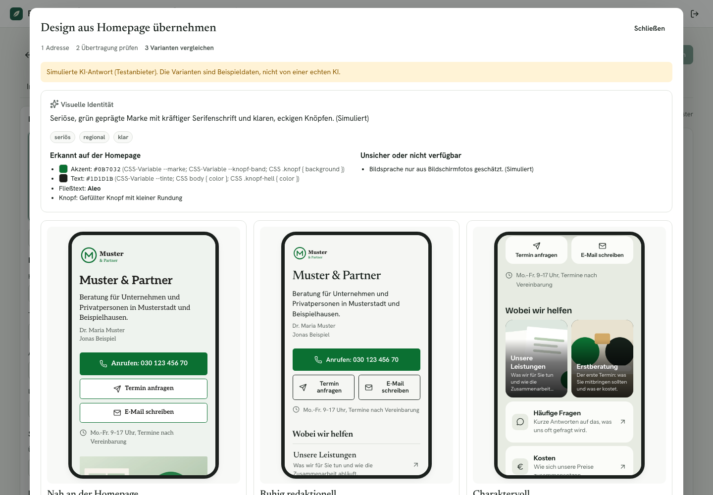
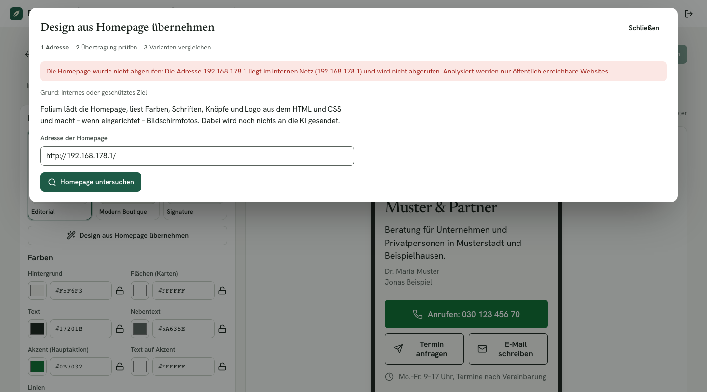

[← Handbuch](README.md) · [Weiter: 7 — Teilen](07-teilen.md)

# 6 — Design aus Homepage übernehmen

Folium kann die Gestaltung einer Homepage untersuchen und daraus mit Hilfe der KI Claude (Anthropic) drei Designvarianten für Ihre Linkseite vorschlagen. Das Ergebnis ist immer nur ein Vorschlag für den **Entwurf**. Sie sehen jede Variante mit Ihren eigenen Inhalten, bevor Sie etwas übernehmen, und nichts wird ohne **Veröffentlichen** öffentlich.

> **Stand der Erprobung:** Der Aufruf der echten KI ist vollständig vorbereitet, wurde aber noch nicht mit einem echten API-Schlüssel getestet. Alle Bildschirmfotos in diesem Kapitel stammen aus einer Testumgebung mit einem **simulierten** KI-Anbieter. Was das bedeutet, steht unter [Simulierte Antworten](#simulierte-antworten).

Die Funktion steht der Rolle **Redaktion** und **Admin** zur Verfügung. Sie öffnen sie im Reiter **Design** mit dem Knopf **Design aus Homepage übernehmen**. Der Ablauf hat drei Schritte, die oben im Fenster angezeigt werden: **1 Adresse**, **2 Übertragung prüfen**, **3 Varianten vergleichen**.

## Schritt 1: Adresse eingeben und untersuchen

1. Im Feld **Adresse der Homepage** steht bereits die Homepage aus den Einstellungen, etwa `https://www.example.com/`; ist dort keine eingetragen, ist das Feld leer. Sie können jede andere öffentliche Adresse eintragen; fehlt `https://`, ergänzt Folium es.
2. **Homepage untersuchen** klicken.

Folium lädt nun abgesichert die Seite und bis zu zehn ihrer Stylesheets, liest Farben (mit ihrer Fundstelle, etwa der CSS-Variable `--marke`), Schriften, Knöpfe und Logo aus und macht, wenn der Browser-Dienst eingerichtet ist, je ein Bildschirmfoto für Desktop und Smartphone. **In diesem Schritt wird noch nichts an die KI gesendet.**

Das dauert meist 5 bis 20 Sekunden. **Abbrechen** führt zurück zur Adresseingabe.

## Schritt 2: Übertragung prüfen

**Links, „Erkannt auf der Homepage“:** Titel und Adresse der Homepage, bis zu zehn Farben mit Fundstelle, bis zu vier Schriften mit ihrer Verwendung und dem Hinweis *mitgeliefert* oder *nicht mitgeliefert – würde ersetzt oder müsste hochgeladen werden*, bis zu zwei Logo-Adressen und Hinweise der Analyse (etwa, dass Einwilligungsbanner für die Bildschirmfotos ausgeblendet wurden oder dass kein Browser eingerichtet ist).

**Rechts, „Bitte prüfen, was übertragen wird“:**

- die Adresse der Homepage,
- die Zahl der ausgelesenen Merkmale (Farben, Schriften, Knöpfe, Logo-Adressen),
- ein Textauszug der Homepage mit Angabe der Zeichenzahl (höchstens 4.000 Zeichen),
- die Bildschirmfotos (Desktop und Smartphone), falls vorhanden,
- Name, Kurzbeschreibung und Art der Einträge Ihrer Linkseite. Titel, Ziele und andere Inhalte der Einträge werden nicht gesendet, personenbezogene Daten Ihrer Besucher erst recht nicht.

Darunter stehen **Empfänger** (*Anthropic (Modell …)*, *niemand (simuliert)* oder *kein Anbieter eingerichtet*) und die **geschätzten Kosten** in Euro, sowie die Bildschirmfotos zur Kontrolle. Haben Sie im Design Werte mit dem Schloss festgehalten, listet Folium sie unter *Festgehalten:* auf.

Erst der Knopf **An Claude senden** ruft die KI auf. **Andere Adresse** führt zurück zu Schritt 1. Wer hier das Fenster schließt, hat nichts gesendet und nichts bezahlt.

### Wie die Kosten geschätzt werden

Folium schätzt die Eingabe anhand der Textmenge und der Bildgröße und rechnet mit einer Antwort von etwa 6.000 Tokens, zum Listenpreis des eingestellten Modells und einem festen Kurs von 0,92 € je US-Dollar. Die Schätzung ist eine Größenordnung, kein Rechnungsbetrag. Nach dem Aufruf zeigt Folium die Kosten auf Basis des tatsächlichen Verbrauchs.

## Schritt 3: Varianten vergleichen

Die KI braucht meist 20 bis 90 Sekunden (*Designvorschläge werden erstellt*). Auch hier gibt es **Abbrechen**.

Das Ergebnis gliedert sich in:

| Bereich | Inhalt |
| --- | --- |
| **Visuelle Identität** | Kurze Beschreibung der Marke und Schlagworte, etwa „seriös“, „regional“, „klar“ |
| **Erkannt auf der Homepage** | Nur Farben, Schriften und Knöpfe, die die KI einem tatsächlich ausgelesenen Merkmal zuordnet, jeweils mit Fundstelle |
| **Unsicher oder nicht verfügbar** | Was die KI nur geschätzt hat oder was Folium nicht belegen konnte |
| **Varianten** | Bis zu drei Karten, siehe unten |

Jede Variantenkarte zeigt eine Smartphone-Vorschau mit **Ihren** Inhalten, Name und Begründung der Variante, die beiden Schriften, vier Farbfelder (Hintergrund, Text, Akzent, Fläche) jeweils mit der Marke **erkannt** oder **Vorschlag**, eine Zeile *Nicht auf der Homepage gefunden, sondern vorgeschlagen: …* und Hinweise, zum Beispiel zu ersetzten Schriften oder angepassten Farben.

**Variante übernehmen** schreibt das Design in den Entwurf: *Design in den Entwurf übernommen. Öffentlich wird es erst nach dem Veröffentlichen.* Der vorherige Stand liegt danach unter **Frühere Entwurfsdesigns** ([Kapitel 5](05-design.md#frühere-entwurfsdesigns)). Im Reiter Design können Sie anschließend jede Einstellung weiter anpassen.

Unten stehen das verwendete Modell, die Kosten dieses Aufrufs und der Knopf **Weitere Varianten erzeugen**, der die KI erneut fragt und erneut kostet.

### Erkannt oder vorgeschlagen?

Folium verlässt sich nicht auf die Aussagen der KI, sondern prüft sie gegen die eigene Analyse:

- Eine Farbe gilt in der Liste „Erkannt“ nur, wenn die KI sie einem ausgelesenen Merkmal zuordnet **und** der Farbwert genau übereinstimmt. Sonst stuft Folium sie herab: *Nicht belegt und daher nicht als erkannt übernommen: Farbe …*
- In den Variantenkarten heißt eine Farbe **erkannt**, wenn genau dieser Wert auf der Homepage vorkommt, sonst **Vorschlag**.
- Schriften, die Folium nicht mitliefert, ersetzt es durch Source Serif 4 (Serifen) oder Hanken Grotesk, mit dem Hinweis *Schrift „…“ … ist nicht mitgeliefert; ersetzt durch …*. Eine passende eigene Schrift können Sie danach im Reiter Design hochladen.
- Ungültige Farbangaben ersetzt Folium durch Ihren aktuellen Wert.
- Zu schwacher Kontrast wird automatisch korrigiert, mit Hinweis wie *Text auf Akzent von #… auf #… angepasst (Kontrast …:1 war zu gering).*

### Festgehaltene Werte

Werte, die Sie im Reiter Design mit dem Schloss festhalten, gibt Folium der KI als unveränderlich mit und setzt sie danach in jeder Variante noch einmal selbst durch. So können Sie etwa Ihre Markenfarbe und Ihre Hausschrift festhalten und nur für den Rest neue Vorschläge holen:

1. Fenster schließen, im Reiter Design die gewünschten Schlösser schließen.
2. **Design aus Homepage übernehmen** erneut öffnen und die Homepage untersuchen.
3. In Schritt 2 erscheint *Festgehalten: colors.accent, fonts.heading …*. Dann senden.

## Wenn etwas nicht klappt

In jedem Fall bleibt der Design-Editor voll nutzbar. Sie können die erkannten Hexwerte aus Schritt 2 auch von Hand in die Farbfelder übernehmen.

### Die Homepage wird nicht abgerufen

Folium ruft aus Sicherheitsgründen nur öffentlich erreichbare Websites ab. Adressen im internen Netz Ihrer Organisation, auf dem Server selbst und interne Adressen von Cloud-Anbietern sind gesperrt. Die Meldung beginnt mit *Die Homepage wurde nicht abgerufen:*, darunter steht der **Grund**:

| Grund | Bedeutung |
| --- | --- |
| Ungültige Adresse | Nur `http://` und `https://`, keine Zugangsdaten in der Adresse |
| Nicht erlaubter Port | Nur die Standardports 80 und 443 |
| Internes oder geschütztes Ziel | Die Adresse zeigt ins interne Netz oder auf einen geschützten Bereich |
| Servername nicht auflösbar | Tippfehler in der Domain oder Domain existiert nicht |
| Zu viele Weiterleitungen | Mehr als 5 Weiterleitungen hintereinander |
| Antwort zu groß | Die Seite ist größer als 2 MB |
| Zeitüberschreitung | Keine Antwort innerhalb von 10 Sekunden |
| Abruflimit erreicht | Mehr als 15 Abrufe oder mehr als 30 Sekunden für eine Analyse |

Weitere Meldungen: *Die Homepage ist nicht erreichbar (…)*, *Die Homepage antwortet mit Status …* und *Unter dieser Adresse liegt keine Webseite (…)*. Einzelne Stylesheets, die nicht geladen werden konnten, stehen nur als Hinweis in der Liste und stoppen die Analyse nicht.

### Die KI ist nicht eingerichtet

Ohne API-Schlüssel auf dem Server läuft Schritt 1 normal. In Schritt 2 fehlt dann der Sendeknopf; stattdessen steht dort *Die KI ist nicht eingerichtet. Sie können das Design unten manuell anpassen und die erkannten Farben links übernehmen.* Die Einrichtung ist Sache der IT ([Kapitel 19](19-ki-anbindung.md)).

### Die KI antwortet nicht oder unbrauchbar

| Meldung (Auszug) | Was tun |
| --- | --- |
| *Die Antwort der KI war unbrauchbar …* | Erneut senden oder manuell gestalten. Folium übernimmt nie eine Antwort, die seine Prüfung nicht besteht. |
| *Die KI hat keine verwendbare Variante geliefert.* | wie oben |
| *Die KI hat die Anfrage abgelehnt. Das manuelle Design bleibt nutzbar.* | Andere Adresse versuchen oder manuell gestalten |
| *Die Antwort der KI war unvollständig.* | Erneut versuchen |
| *Die KI hat nicht innerhalb von … Sekunden geantwortet.* | Später erneut versuchen; Standard sind 120 Sekunden |
| *Der KI-Anbieter begrenzt gerade die Anfragen …* / *… ist gerade überlastet …* | In einigen Minuten erneut versuchen |
| *Der API-Schlüssel wurde abgelehnt …*, *Das Modell „…“ ist nicht verfügbar …*, *… nicht erreichbar (Netzwerk) …* | Die IT informieren |
| *Diese Analyse ist abgelaufen. Bitte die Homepage erneut untersuchen.* | Eine Analyse bleibt 2 Stunden gültig; danach Schritt 1 wiederholen |

## Kostenbremse

Damit die KI-Kosten überschaubar bleiben, begrenzt Folium die Zahl der Aufrufe. Die Standardwerte (die IT kann sie ändern):

| Grenze | Standard | Meldung |
| --- | --- | --- |
| je Person und Stunde | 10 Aufrufe | *Sie haben in der letzten Stunde schon 10 Analysen gestartet. Bitte später erneut versuchen.* |
| für alle zusammen je Tag | 30 Aufrufe | *Das Tageslimit von 30 KI-Analysen ist erreicht. Morgen geht es weiter; das manuelle Design bleibt nutzbar.* |
| für alle zusammen je Monat | 20 € | *Das Monatsbudget von 20 € für die KI ist ausgeschöpft (verbraucht: … €).* |

Gezählt wird jedes **An Claude senden** und jedes **Weitere Varianten erzeugen**, auch wenn der Aufruf scheitert. Nicht gezählt werden das Untersuchen der Homepage (Schritt 1) und wiederverwendete Ergebnisse: Senden Sie innerhalb von 24 Stunden für dieselbe Seite die unveränderte Homepage mit demselben Design und denselben Schlössern erneut, liefert Folium das frühere Ergebnis ohne neue Kosten (*Ergebnis aus den letzten 24 Stunden wiederverwendet (keine neuen Kosten).*). Die Kosten des laufenden Monats und die Zahl der Analysen heute sehen Redaktion und Admins unter **Einstellungen → KI und Verbindungen** ([Kapitel 11](11-einstellungen.md)).

## Simulierte Antworten

Für Tests und Vorführungen kann die IT einen **Testanbieter** einstellen (`AI_PROVIDER=fake`). Er ruft keine echte KI auf und kostet nichts. Folium kennzeichnet das deutlich:

- In Schritt 2 steht oben *Simulierte KI-Antwort: In dieser Umgebung ist ein Testanbieter eingestellt (AI_PROVIDER=fake). Es wird keine echte KI aufgerufen.*, als Empfänger *niemand (simuliert)*, und der Knopf heißt **An Testanbieter senden**.
- In Schritt 3 steht *Simulierte KI-Antwort (Testanbieter). Die Varianten sind Beispieldaten, nicht von einer echten KI.* Die Texte tragen den Zusatz „(Simuliert)“.

Simulierte Aufrufe zählen nicht für die Kostenbremse. Im echten Betrieb ist der Testanbieter nicht eingestellt.

---

[← Handbuch](README.md) · [Weiter: 7 — Teilen](07-teilen.md)
