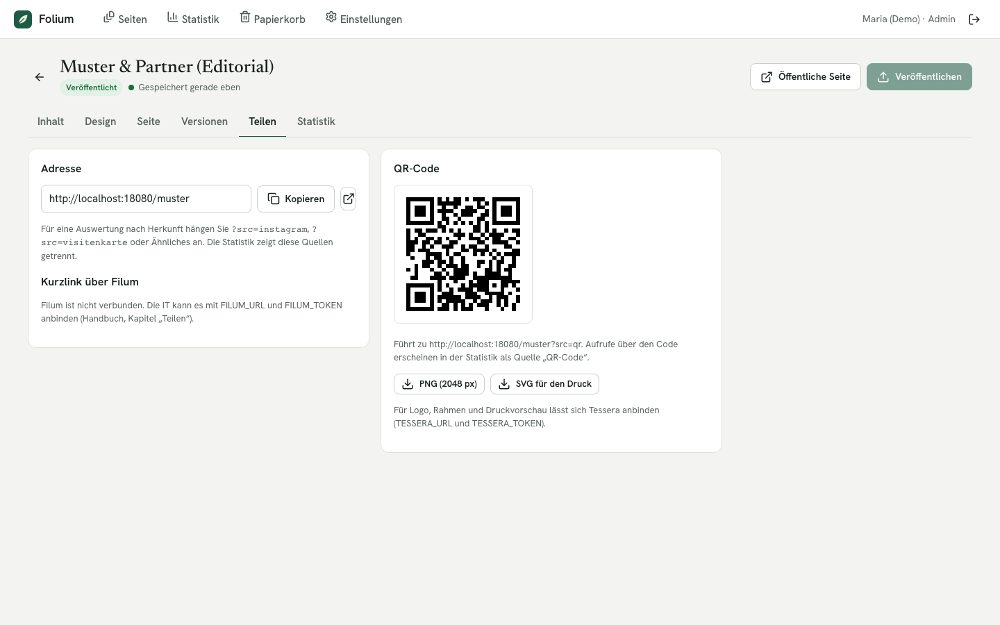

[← Handbuch](README.md) · [Weiter: 8 — Statistik](08-statistik.md)

# 7 — Teilen

Der Reiter **Teilen** einer Seite bündelt alles, was Sie brauchen, um die Linkseite unter die Leute zu bringen: Adresse, QR-Code und, wenn angebunden, Kurzlink und QR-Gestaltung. Er ist erst nutzbar, wenn die Seite veröffentlicht ist. Vorher steht dort *Noch nicht veröffentlicht. Veröffentlichen Sie die Seite zuerst. Danach finden Sie hier Adresse, QR-Code und Kurzlink.*

Nach dem Veröffentlichen kommen Sie am schnellsten über den Knopf **Teilen** in der Meldung *Veröffentlicht als Version N.* hierher.

## Adresse kopieren

Im Bereich **Adresse** steht die öffentliche Adresse, etwa `https://links.example.com/muster`.

- **Kopieren** legt sie in die Zwischenablage (*Adresse kopiert.*).
- Das Symbol daneben öffnet die öffentliche Seite in einem neuen Tab.
- Klappt das Kopieren im Browser nicht, meldet Folium *Kopieren nicht möglich. Bitte die Adresse markieren und kopieren.* Ein Klick in das Feld markiert die ganze Adresse.

Admins können zusätzlich eigene Domains einrichten, unter denen eine Seite direkt erreichbar ist, etwa `links.maria-muster.de` ohne Pfad ([Kapitel 9](09-domains.md)).

## Quellen mit `?src=`

Wenn Sie wissen wollen, über welchen Weg Besucher kommen, hängen Sie an die Adresse ein Kennwort an:

| Einsatz | Adresse |
| --- | --- |
| Instagram-Profil | `https://links.example.com/muster?src=instagram` |
| Visitenkarte | `https://links.example.com/muster?src=visitenkarte` |
| E-Mail-Signatur | `https://links.example.com/muster?src=signatur` |
| QR-Code aus Folium | `…/muster?src=qr` (setzt Folium selbst) |

Die Statistik zeigt jede Quelle in einer eigenen Zeile, `qr` als **QR-Code**, Besuche ohne Kennwort als **Direkt / unbekannt** ([Kapitel 8](08-statistik.md#quellen)).

Regeln für das Kennwort: nur Kleinbuchstaben a–z, Ziffern und Bindestrich, höchstens 32 Zeichen. Alles andere zählt Folium als „Direkt / unbekannt“.

> **Gut zu wissen:** Verwenden Sie das Kennwort immer klein geschrieben. Bei `?src=Instagram` ordnet Folium die Aufrufe zwar der Quelle `instagram` zu, die Klicks auf Einträge aber „Direkt / unbekannt“.

## QR-Code

Im Bereich **QR-Code** zeigt Folium den fertigen Code. Er führt immer zur Adresse mit `?src=qr`, damit Aufrufe über den Code in der Statistik als Quelle **QR-Code** erscheinen. Darunter steht die genaue Zieladresse.

| Knopf | Ergebnis |
| --- | --- |
| **PNG (2048 px)** | Bilddatei `qr-<adresse>.png`, 2048 × 2048 Pixel; gut für Präsentationen, Social Media und Office-Dokumente |
| **SVG für den Druck** | Vektordatei `qr-<adresse>.svg`, beliebig vergrößerbar ohne Qualitätsverlust; für Druckerei und Grafik |

Der Code ist schwarz auf weiß, mit schmalem Rand und mittlerer Fehlerkorrektur. Ein Logo in der Mitte, Farben oder Rahmen bietet Folium selbst nicht; dafür gibt es Tessera (siehe unten).

Da der QR-Code die Adresse der Seite enthält, bleibt er gültig, solange sich die **Adresse** nicht ändert. Inhalte und Design können Sie jederzeit ändern, ohne neu drucken zu müssen. Ändern Sie dagegen die Adresse im Reiter **Seite**, führen gedruckte Codes ins Leere ([Kapitel 3](03-seiten-bearbeiten.md#automatisches-speichern)).

## Kurzlink über Filum

Ist Filum angebunden, steht im Bereich **Adresse** der Knopf **Kurzlink in Filum anlegen**. Ein Klick legt in Filum einen Kurzlink an:

- Ziel ist die öffentliche Adresse der Seite (ohne `?src=`).
- Titel in Filum: „Linkseite: <Name der Seite>“, Schlagwort „Folium“.
- Folium zeigt den Kurzlink danach mit eigenem **Kopieren**-Knopf.

Folium merkt sich den Kurzlink nicht dauerhaft. Wiederfinden, bearbeiten und auswerten können Sie ihn in Filum, zum Beispiel über das Schlagwort „Folium“.

Ist Filum nicht angebunden, steht dort *Filum ist nicht verbunden. Die IT kann es mit FILUM_URL und FILUM_TOKEN anbinden (Handbuch, Kapitel „Teilen“).* Die Einrichtung beschreibt [Kapitel 15](15-konfiguration.md). Mögliche Fehlermeldungen beim Anlegen:

| Meldung | Bedeutung |
| --- | --- |
| *Filum ist nicht erreichbar (…).* | Filum läuft nicht oder ist vom Server aus nicht erreichbar |
| *Filum hat die Anfrage abgelehnt (HTTP 401) … Bitte das API-Token prüfen.* | Das hinterlegte Token stimmt nicht; IT informieren |
| *Bitte die Seite zuerst veröffentlichen.* | Nur veröffentlichte Seiten bekommen einen Kurzlink |

> **Gut zu wissen:** Besuche über den Filum-Kurzlink erscheinen in der Folium-Statistik als „Direkt / unbekannt“, weil der Kurzlink auf die Adresse ohne `?src=` zeigt. Filum zählt die Aufrufe seines Kurzlinks selbst.

## In Tessera gestalten

Ist Tessera angebunden, steht im Bereich **QR-Code** zusätzlich der Knopf **In Tessera gestalten**. Ein Klick legt in Tessera einen neuen QR-Code an und öffnet ihn dort in einem neuen Tab:

- Inhalt: die Adresse der Seite mit `?src=qr`, also derselbe Inhalt wie beim Folium-Code. Aufrufe zählen deshalb auch hier als Quelle **QR-Code**.
- Name: „Linkseite <Name der Seite>“, Schlagwort „Folium“, Notiz „Erstellt aus Folium für /<adresse>“.

In Tessera gestalten Sie den Code dann mit Logo, Farben, Rahmen und Druckvorschau. Klicken Sie den Knopf nur einmal je Seite; Folium schickt bei jedem Klick eine neue Anlage-Anfrage an Tessera.

Ist Tessera nicht angebunden, fehlt der Knopf, und Folium weist darauf hin: *Für Logo, Rahmen und Druckvorschau lässt sich Tessera anbinden (TESSERA_URL und TESSERA_TOKEN).*

Folium nutzt für Filum und Tessera nur deren vorhandene Schnittstellen und verändert an den beiden Programmen nichts. Kurzlinks und Codes anlegen kann die Rolle **Redaktion** oder **Admin**.

---

[← Handbuch](README.md) · [Weiter: 8 — Statistik](08-statistik.md)
