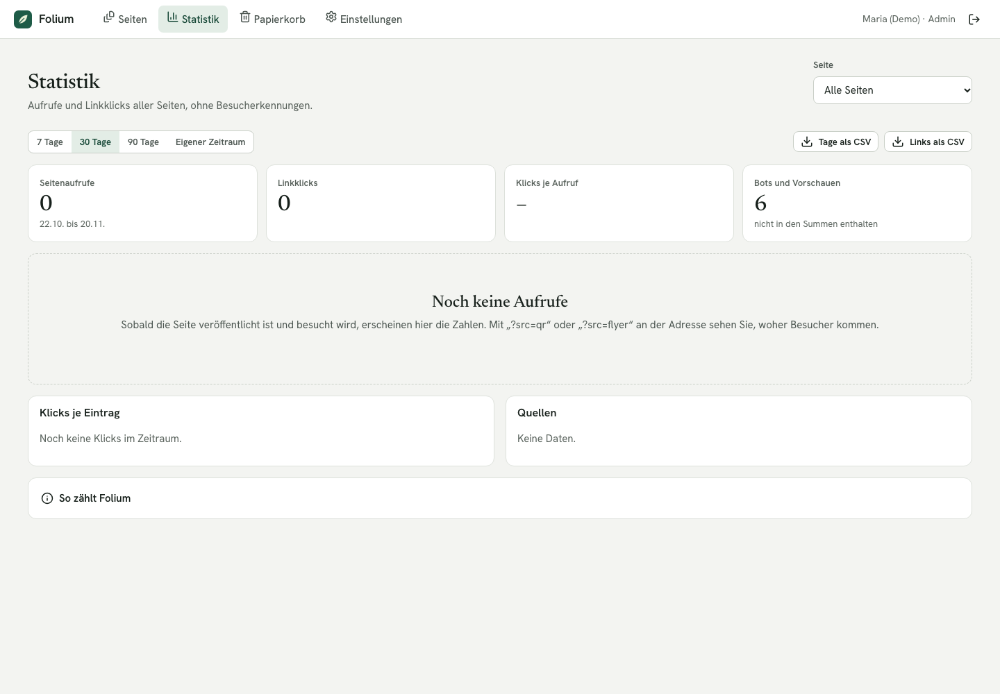

[← Handbuch](README.md) · [Weiter: 9 — Domains](09-domains.md)

# 8 — Statistik

*Aufrufe und Linkklicks aller Seiten, ohne Besucherkennungen.* So steht es über der Ansicht **Statistik**, und so ist sie gebaut. Folium zeigt, wie oft eine Seite aufgerufen und welche Einträge angeklickt wurden, aber nicht, wer das war.

Die Statistik gibt es an zwei Stellen:

- **Statistik** in der Hauptnavigation: alle Seiten zusammen. Mit dem Auswahlfeld **Seite** oben rechts schränken Sie auf eine Seite ein (**Alle Seiten** ist voreingestellt).
- Reiter **Statistik** im Editor einer Seite: nur diese Seite.

Alle Rollen, auch **Ansehen**, dürfen die Statistik sehen und herunterladen.

## Was gezählt wird und wie

| Zahl | Wie sie entsteht |
| --- | --- |
| **Seitenaufrufe** | Der Server zählt, wenn er eine veröffentlichte Seite an einen Browser ausliefert. |
| **Linkklicks** | Tippt jemand auf einen Eintrag, schickt die Seite eine kleine Meldung ohne Cookie und ohne Kennung an Folium. |

Als Klick zählen: Hauptaktionen (auch die mitlaufende Pille), Links, Telefon und E-Mail im Kontakt-Eintrag, „Route planen“ beim Standort und die Profile unter Social Media. Die Links zu Impressum und Datenschutz zählt Folium nicht. Klicks in der Vorschau der Verwaltung werden ebenfalls nicht gezählt.

**Aufrufe sind keine Personen.** Wer die Seite zweimal öffnet, zählt doppelt. Wer sie einmal öffnet und drei Links antippt, erzeugt einen Aufruf und drei Klicks.

**Tagessummen.** Gespeichert wird nur, wie oft an einem Tag je Seite, je Eintrag und je Quelle aufgerufen oder geklickt wurde. Folium speichert keine IP-Adressen, keine Geräte- oder Browserangaben und keine Besucherkennungen. Der Tag richtet sich nach der eingestellten Zeitzone (`APP_TIMEZONE`, Standard Europe/Berlin).

**Bots und Vorschauen.** Suchmaschinen, Überwachungsdienste und Link-Vorschauen (etwa wenn jemand den Link in WhatsApp oder LinkedIn teilt und dort eine Vorschaukarte entsteht) erkennt Folium an der Kennung, die sie selbst mitschicken. Sie stehen getrennt in der Kachel **Bots und Vorschauen** und sind in keiner anderen Zahl enthalten. Abrufe ganz ohne Browserkennung zählen ebenfalls als Bot.

**Verzögerung.** Neue Zählungen sammelt Folium im Arbeitsspeicher und schreibt sie alle drei Sekunden in die Datenbank. Die Statistik kann daher bis zu drei Sekunden hinterherhinken.

### Die Zählung blockiert nie einen Link

Jeder Eintrag ist ein ganz normaler Link direkt zum Ziel. Die Klickmeldung läuft nebenher, und Folium beantwortet sie immer sofort, auch wenn beim Zählen etwas schiefgeht. Fällt die Zählung aus, ist der Werbeblocker eines Besuchers aktiv oder ist die Statistik abgeschaltet, funktionieren alle Links unverändert. Es fehlen dann nur Zahlen.

## Zeitraum wählen

Oben links: **7 Tage**, **30 Tage** (voreingestellt), **90 Tage** und **Eigener Zeitraum**. Beim eigenen Zeitraum erscheinen die Felder **Von** und **Bis**. Alle Zahlen und beide Tabellen-Downloads beziehen sich auf den gewählten Zeitraum.

## Die Kennzahlen

| Kachel | Bedeutung |
| --- | --- |
| **Seitenaufrufe** | Summe der Aufrufe im Zeitraum, darunter der Zeitraum |
| **Linkklicks** | Summe der Klicks |
| **Klicks je Aufruf** | Linkklicks geteilt durch Seitenaufrufe, in Prozent. Über 100 % ist möglich, wenn Besucher mehrere Einträge antippen. |
| **Bots und Vorschauen** | Erkannte automatische Abrufe, *nicht in den Summen enthalten* |

## Die Diagramme

Gibt es im Zeitraum Aufrufe oder Klicks, zeigt Folium zwei Säulendiagramme: **Aufrufe pro Tag** und **Klicks pro Tag**. Jeder Tag des Zeitraums hat seinen Platz auf der Zeitachse, auch Tage ohne Zählung (Wert 0). Fahren Sie mit der Maus über eine Säule oder steuern Sie sie mit der Tab-Taste an, erscheinen Datum und Wert.

Gibt es noch keine Zahlen, steht dort *Noch keine Aufrufe* mit dem Hinweis auf `?src=`.

## Klicks je Eintrag

Die Tabelle **Klicks je Eintrag** listet die meistgeklickten Einträge mit:

- **Eintrag**: Titel des Links oder Beschriftung der Hauptaktion; bei Standorten „Route …“, beim Kontakt „Kontaktzeile“, bei Social Media „Social Media“. Ein kleiner Balken zeigt das Verhältnis zum meistgeklickten Eintrag.
- **Seite** (nur in der Gesamtansicht).
- **Klicks**.
- **je Aufruf**: Klicks des Eintrags geteilt durch die Aufrufe seiner Seite.

Die Titel stammen aus dem aktuellen Entwurf. Ein Eintrag, den es dort nicht mehr gibt, erscheint als „Entfernter Eintrag“; eine endgültig gelöschte Seite als „Gelöschte Seite“.

In der Gesamtansicht steht daneben die Tabelle **Seiten** mit Aufrufen und Klicks je Seite. Ein Klick auf den Namen öffnet die Statistik dieser Seite.

## Quellen

Die Tabelle **Quellen** schlüsselt Aufrufe und Klicks nach dem Kennwort `?src=` auf:

| Anzeige | Herkunft |
| --- | --- |
| **QR-Code** | Adresse mit `?src=qr`, also der QR-Code aus Folium oder aus Tessera |
| **Direkt / unbekannt** | Adresse ohne gültiges Kennwort, z. B. abgetippt, aus einem Lesezeichen oder über einen Filum-Kurzlink |
| das Kennwort selbst | z. B. `instagram`, `visitenkarte` |

Wie Sie Quellen anlegen, steht in [Kapitel 7](07-teilen.md#quellen-mit-src).

## So zählt Folium

Unten in der Statistik klappt **So zählt Folium** eine Kurzfassung dieses Kapitels auf. Dort steht auch, nach wie vielen Tagen die Tagessummen gelöscht werden.

## Export als CSV

Oben rechts stehen zwei Knöpfe:

| Knopf | Datei | Spalten |
| --- | --- | --- |
| **Tage als CSV** | `folium-statistik-tage-<von>-bis-<bis>.csv` | Tag; Aufrufe; Klicks |
| **Links als CSV** | `folium-statistik-links-<von>-bis-<bis>.csv` | Seite; Eintrag; Klicks; Klickrate % |

Die Dateien verwenden Semikolon als Trennzeichen und UTF-8 mit Kennung, sodass Excel und LibreOffice Umlaute richtig anzeigen. Inhalte, die mit `=`, `+`, `-` oder `@` beginnen, versieht Folium mit einem vorangestellten Apostroph, damit Tabellenprogramme sie nicht als Formel ausführen.

## Aufbewahrung und Abschalten

- Tagessummen werden nach **730 Tagen** gelöscht (Standard). Admins stellen die Frist unter **Einstellungen → Allgemein → Statistik aufbewahren (Tagen)** zwischen 30 und 3650 Tagen ein. Folium räumt stündlich auf.
- Unter **Aufrufe und Klicks zählen** lässt sich die Statistik ganz abschalten. Die Ansicht zeigt dann *Die Statistik ist in den Einstellungen abgeschaltet. Es werden keine neuen Aufrufe gezählt.* Bereits gezählte Tage bleiben sichtbar.

Siehe [Kapitel 11](11-einstellungen.md) und [Kapitel 12](12-datenschutz.md).

## Andere Zahlen, andere Quellen

Folium ist nicht die einzige Stelle, die zählt. Die Zugriffsprotokolle des Reverse Proxy (etwa Caddy) enthalten jeden Abruf mit IP-Adresse und eigener Aufbewahrung; Filum zählt die Aufrufe seiner Kurzlinks, Tessera die seiner QR-Codes, soweit dort eingerichtet. Diese Zahlen weichen von Folium ab, weil sie anders zählen. Keine davon ist falsch; vergleichen Sie Entwicklungen, nicht einzelne Werte.

---

[← Handbuch](README.md) · [Weiter: 9 — Domains](09-domains.md)
