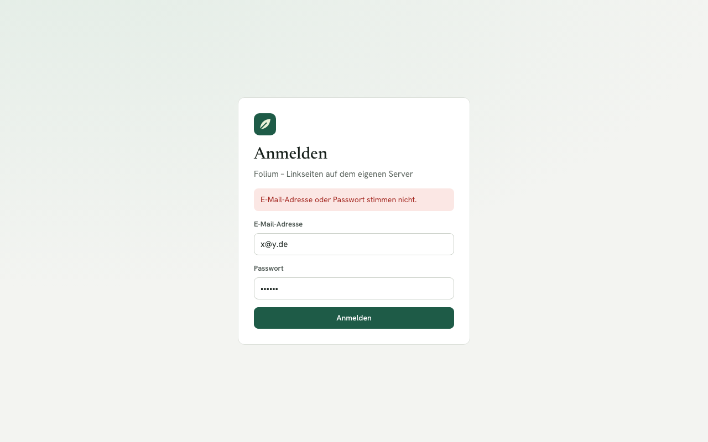

# 10 — Konten und Rollen

[← Handbuch](README.md) · [Weiter: 11 — Einstellungen](11-einstellungen.md)

> Dieses Kapitel richtet sich an Admins. Nur Admins sehen den Bereich **Einstellungen → Konten**.

Jede Person meldet sich mit einem eigenen Konto an. Ein Konto hat eine E-Mail-Adresse, einen Namen und genau eine von drei Rollen. Konten entstehen auf zwei Wegen: Ein Admin legt sie in Folium an, oder sie entstehen bei der ersten Anmeldung über authentik ([Kapitel 16](16-anmeldung-oidc.md)).

## Die drei Rollen

| Was | Ansehen | Redaktion | Admin |
| --- | :---: | :---: | :---: |
| Seiten, Vorschau, Versionen und Papierkorb ansehen | ✓ | ✓ | ✓ |
| Statistik ansehen und als CSV herunterladen | ✓ | ✓ | ✓ |
| Adresse kopieren, QR-Code herunterladen | ✓ | ✓ | ✓ |
| Einstellungen **Allgemein** und **Domains** ansehen | ✓ | ✓ | ✓ |
| Seiten anlegen, bearbeiten, veröffentlichen, duplizieren, löschen und aus dem Papierkorb holen | – | ✓ | ✓ |
| Ältere Versionen wiederherstellen, frühere Entwurfsdesigns zurückholen | – | ✓ | ✓ |
| Bilder und Schriften hochladen und löschen | – | ✓ | ✓ |
| Design aus Homepage übernehmen (Analyse und KI) | – | ✓ | ✓ |
| Kurzlink in Filum anlegen, QR-Code in Tessera gestalten | – | ✓ | ✓ |
| Bereich **KI und Verbindungen** ansehen (Status, Verbrauch) | – | ✓ | ✓ |
| Alle Seiten als ZIP exportieren | – | ✓ | ✓ |
| Einstellungen **Allgemein** ändern, Domains eintragen und entfernen | – | – | ✓ |
| KI-Verbindung prüfen | – | – | ✓ |
| Konten verwalten, Export importieren, Sicherungen anlegen und wiederherstellen, Protokoll lesen | – | – | ✓ |

In der Oberfläche heißen die Rollen **Admin**, **Redaktion** und **Ansehen**. Die Rechte prüft der Server bei jeder Anfrage; was eine Rolle nicht darf, wird auch über die Schnittstelle abgelehnt („Dafür fehlt Ihnen die Berechtigung.“).

## Ein Konto anlegen

1. **Einstellungen → Konten**, unten **Konto anlegen**.
2. **E-Mail**, **Name** und **Rolle** eintragen. Vorbelegt ist „Redaktion“.
3. **Erstes Passwort** vergeben: mindestens 12, höchstens 200 Zeichen.
4. **Konto anlegen**. Folium meldet „Konto angelegt. Bitte das Passwort auf sicherem Weg weitergeben.“

Folium verschickt keine E-Mails und keine Einladungen. Geben Sie E-Mail-Adresse und Passwort persönlich oder über einen sicheren Kanal weiter, nicht im Klartext per E-Mail. Pro E-Mail-Adresse gibt es nur ein Konto („Für diese E-Mail-Adresse gibt es schon ein Konto.“).

## Rolle ändern, sperren, löschen

Die Tabelle in **Einstellungen → Konten** zeigt je Konto Name, E-Mail-Adresse, Rolle und **Zuletzt angemeldet**. Der Zusatz „· authentik“ kennzeichnet Konten aus der Anmeldung über authentik, „· gesperrt“ gesperrte Konten.

| Aktion | So geht es | Wirkung |
| --- | --- | --- |
| Rolle ändern | Auswahlfeld in der Spalte **Rolle** | sofort, auch für bereits angemeldete Personen |
| Sperren | Knopf **Sperren** | alle Sitzungen des Kontos enden sofort, eine neue Anmeldung ist nicht möglich |
| Entsperren | Knopf **Entsperren** | Anmeldung wieder möglich |
| Löschen | Papierkorb-Symbol, Rückfrage „Konto löschen?“ bestätigen | das Konto ist entfernt, die Person kann sich nicht mehr anmelden |

Schutzregeln:

- Das **eigene Konto** können Sie weder in der Rolle ändern noch sperren oder löschen.
- Das **letzte aktive Admin-Konto** lässt sich nicht herabstufen, sperren oder löschen („Das letzte aktive Admin-Konto kann nicht herabgestuft oder gesperrt werden.“).
- Seiten, Versionen und Protokolleinträge einer gelöschten Person bleiben erhalten; dort steht weiterhin ihre E-Mail-Adresse.

Gut zu wissen: Bei Konten aus authentik setzt Folium die Rolle **bei jeder Anmeldung** neu aus den Gruppen in authentik (oder aus der Standardrolle). Eine in Folium von Hand geänderte Rolle hält deshalb nur bis zur nächsten Anmeldung. Dauerhaft ändern Sie sie über die Gruppenzugehörigkeit in authentik.

## Passwörter

Die Oberfläche hat derzeit **kein Feld zum Ändern des Passworts**, weder für das eigene Konto noch für andere. Ein neues Passwort setzt die IT auf der Kommandozeile:

```bash
docker compose exec folium folium passwort person@example.com
# Neues Passwort für person@example.com: …
# Bitte nach der Anmeldung ändern. Alle Sitzungen dieses Kontos wurden beendet.
```

Folium erzeugt dabei ein zufälliges Passwort und zeigt es einmalig an. Alle Sitzungen des Kontos enden. Der Vorgang wird im Protokoll als `user.password_reset_cli` festgehalten. Konten, die bei der ersten Anmeldung über authentik entstanden sind, haben in Folium kein eigenes Passwort; ihr Passwort verwaltet authentik.

## Anmelden, Sitzung, Anmeldesperre



- Nach der Anmeldung bleibt die Sitzung **14 Tage** gültig. Abmelden: Symbol oben rechts neben dem eigenen Namen.
- Falsche Angaben quittiert Folium mit „E-Mail-Adresse oder Passwort stimmen nicht.“ Ob es die E-Mail-Adresse gibt, verrät die Meldung nicht.
- **Anmeldesperre:** Nach **5 Fehlversuchen innerhalb von 15 Minuten** für dieselbe E-Mail-Adresse sperrt Folium weitere Versuche für **15 Minuten** („Zu viele fehlgeschlagene Anmeldungen. Bitte in … Minuten erneut versuchen.“). Eine erfolgreiche Anmeldung setzt den Zähler zurück.
- Die Sperre liegt nur im Arbeitsspeicher. Muss sie vorzeitig aufgehoben werden, genügt ein Neustart (`docker compose restart folium`, [Kapitel 18](18-betrieb.md)). Einen Knopf dafür gibt es nicht.
- Zusätzlich nimmt Folium je Absenderadresse höchstens 30 Anmeldeversuche pro Minute an.

## Anmeldung über authentik (Sicht der Mitarbeitenden)

Hat die IT die Anmeldung über authentik eingerichtet ([Kapitel 16](16-anmeldung-oidc.md)), zeigt die Anmeldeseite den Knopf **Mit authentik anmelden** (die Beschriftung kann die IT ändern).

1. **Mit authentik anmelden** wählen.
2. Bei authentik anmelden, wie bei anderen Anwendungen Ihrer Organisation auch.
3. Sie landen angemeldet in Folium. Beim ersten Mal legt Folium dabei Ihr Konto an.

Welche Rolle Sie erhalten, bestimmen Ihre Gruppen in authentik. Ist Ihr Konto keiner passenden Gruppe zugeordnet und hat die IT keine Standardrolle vorgesehen, wird die Anmeldung abgelehnt. Schlägt die Anmeldung fehl, landen Sie wieder auf der Anmeldeseite; eine Fehlermeldung zeigt die Seite dabei derzeit **nicht** an. Den Grund findet die IT im Serverprotokoll (Eintrag „OIDC-Anmeldung fehlgeschlagen“).

Ist die Passwort-Anmeldung abgeschaltet (`DISABLE_LOCAL_LOGIN`), zeigt die Anmeldeseite nur noch diesen Knopf.

## Protokoll

Folium hält Verwaltungsaktionen in einem Protokoll fest: wer (E-Mail-Adresse), wann, welche Aktion, an welchem Objekt. Beispiele:

| Bereich | Einträge |
| --- | --- |
| Anmeldung | `setup`, `login`, `login.oidc` |
| Konten | `user.create`, `user.update`, `user.delete`, `user.password_reset_cli` |
| Seiten | `page.create`, `page.rename`, `page.publish`, `page.duplicate`, `page.delete`, `page.restore`, `page.restore_version` |
| Design und Dateien | `design.analyze`, `design.propose`, `page.theme_ai`, `asset.upload`, `asset.delete` |
| Verwaltung | `settings.update`, `domain.create`, `domain.delete`, `export`, `import`, `backup.create`, `backup.restore_staged` |
| Teilen | `share.filum`, `share.tessera` |

Das automatische Speichern von Entwürfen erscheint nicht einzeln im Protokoll. Abmeldungen werden nicht protokolliert.

**Lesen:** Eine eigene Ansicht in der Oberfläche gibt es derzeit nicht. Admins rufen im angemeldeten Browser die Adresse `<Verwaltungsadresse>/api/v1/audit` auf, z. B. `https://folium.intranet.example.com/api/v1/audit`. Folium liefert die neuesten 200 Einträge als JSON; ältere mit `?before=<id>` (die kleinste `id` der vorherigen Antwort). Das Protokoll wird nicht automatisch gelöscht.

---

[← Handbuch](README.md) · [Weiter: 11 — Einstellungen](11-einstellungen.md)
