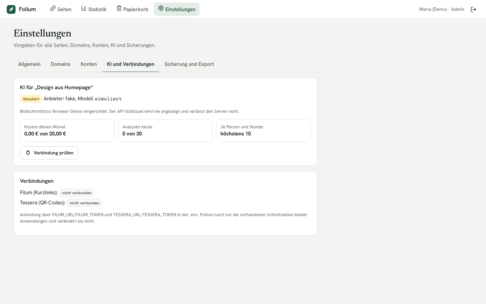

# 11 — Einstellungen

[← Handbuch](README.md) · [Weiter: 12 — Datenschutz](12-datenschutz.md)

> Dieses Kapitel richtet sich an Admins. Andere Rollen sehen einen Teil der Bereiche nur lesend.

**Einstellungen** in der oberen Leiste öffnet fünf Bereiche. Welche davon erscheinen, hängt von der Rolle ab:

| Bereich | Ansehen | Redaktion | Admin |
| --- | --- | --- | --- |
| Allgemein | lesen | lesen | lesen und ändern |
| Domains | lesen | lesen | lesen und ändern |
| Konten | – | – | lesen und ändern |
| KI und Verbindungen | – | lesen | lesen, **Verbindung prüfen** |
| Sicherung und Export | – | nur **Alles exportieren** | alles |

Was in der Oberfläche nicht einstellbar ist (Adressen, KI-Schlüssel, Sicherungsintervall, Anmeldung über authentik), legt die IT in der Datei `.env` fest ([Kapitel 15](15-konfiguration.md)).

## Allgemein

Änderungen in diesem Bereich werden erst mit **Speichern** wirksam. Den Knopf sehen nur Admins.

### Pflichtangaben für neue Seiten

| Feld | Standard | Wirkung |
| --- | --- | --- |
| **Impressum** | leer | wird in **neu angelegte** Seiten als Impressum-Link übernommen, z. B. `https://www.example.com/impressum/` |
| **Datenschutzerklärung** | leer | wird in **neu angelegte** Seiten als Datenschutz-Link übernommen, z. B. `https://www.example.com/datenschutz/` |
| **Homepage (Vorgabe für „Design aus Homepage“)** | leer | vorbelegte Adresse beim Ablauf „Design aus Homepage übernehmen“ ([Kapitel 6](06-design-aus-homepage.md)) und Ziel der Links in den Inhaltsvorlagen, z. B. `https://www.example.com/` |
| **Standard-Designrichtung** | Editorial | siehe Hinweis unten |

Erlaubt sind nur Adressen mit `http://` oder `https://` (höchstens 500 Zeichen) oder ein leeres Feld.

> **Bei der Einrichtung ausfüllen:** Nach der Installation sind Impressum, Datenschutzerklärung und Homepage leer. Tragen Sie sie ein, bevor die ersten Seiten angelegt werden. Fehlen sie, entstehen neue Seiten ohne Impressum- und Datenschutz-Link; der Dialog **Veröffentlichen** meldet dann *Impressum und Datenschutzerklärung fehlen. Bitte im Bereich „Seite“ eintragen.* und sperrt den Knopf **Jetzt veröffentlichen**, bis beide Links im Reiter **Seite** der jeweiligen Seite stehen. Ohne Homepage zeigen die Links der Inhaltsvorlagen auf den Platzhalter `https://www.example.com`.

Gut zu wissen:

- Impressum und Datenschutz gelten nur für **künftige** Seiten. Bestehende Seiten behalten ihre Links; diese ändern Sie im Editor der jeweiligen Seite. Ohne beide Links lässt sich eine Seite nicht veröffentlichen ([Kapitel 4](04-veroeffentlichen-und-versionen.md)).
- Die Datenschutzerklärung der Homepage sollte den Abschnitt zu Folium enthalten; einen Textbaustein enthält [Kapitel 12](12-datenschutz.md#textbaustein-für-die-datenschutzerklärung).
- **Standard-Designrichtung** wird gespeichert, wirkt sich in Version 0.1.0 aber noch nicht aus: Der Dialog **Neue Seite** beginnt immer mit „Editorial“. Die Richtung wählen Sie dort selbst.

### Statistik und Aufbewahrung

| Feld | Standard | Erlaubt | Wirkung |
| --- | --- | --- | --- |
| **Aufrufe und Klicks zählen (nur Tagessummen, keine Besucherdaten)** | an | an/aus | aus: Folium zählt ab sofort nichts mehr; vorhandene Zahlen bleiben bis zum Ablauf der Aufbewahrung |
| **Statistik aufbewahren (Tage)** | 730 | 30–3650 | ältere Tagessummen löscht Folium automatisch |
| **Papierkorb leeren nach (Tagen)** | 30 | 1–365 | Seiten, die länger im Papierkorb liegen, löscht Folium endgültig |

Die Aufräumarbeiten laufen beim Start und danach stündlich. Eine verkürzte Frist wirkt also spätestens nach einer Stunde. Endgültig gelöschte Seiten lassen sich nur noch über eine Sicherung zurückholen ([Kapitel 17](17-sicherung.md)).

## Domains

Standardadresse und weitere Domains mit eigener Startseite. Ausführlich in [Kapitel 9](09-domains.md).

## Konten

Konten anlegen, Rollen ändern, sperren und löschen. Ausführlich in [Kapitel 10](10-konten-und-rollen.md).

## KI und Verbindungen

### KI für „Design aus Homepage“

Der Kasten zeigt den Zustand der KI-Anbindung:

| Anzeige | Bedeutung |
| --- | --- |
| **Eingerichtet** · Anbieter: Anthropic Claude, Modell `…` | ein API-Schlüssel ist hinterlegt; das Modell steht in der `.env` (`AI_MODEL`) |
| **Simuliert** | Testbetrieb ohne echte KI (`AI_PROVIDER=fake`); die Vorschläge sind erfunden und nur für Tests gedacht |
| **Nicht eingerichtet** | kein Schlüssel hinterlegt; die IT trägt `ANTHROPIC_API_KEY` in die `.env` ein. Der manuelle Design-Editor funktioniert auch ohne KI. |

Darunter steht, ob der **Browser-Dienst** für Bildschirmfotos eingerichtet ist. Ohne ihn analysiert Folium Homepages nur über HTML und CSS. Der API-Schlüssel wird nie angezeigt und verlässt den Server nicht.

**Verbrauch:**

| Kachel | Inhalt |
| --- | --- |
| **Kosten diesen Monat** | geschätzte Kosten aller echten KI-Aufrufe im laufenden Monat, daneben das Monatsbudget (`AI_MONTHLY_BUDGET_EUR`, Standard 20 €) |
| **Analysen heute** | Zahl der KI-Aufrufe heute und das Tageslimit (`AI_DAILY_LIMIT`, Standard 30) |
| **Je Person und Stunde** | Höchstzahl je Person und Stunde (`AI_HOURLY_PER_USER`, Standard 10) |

Ist eine Grenze erreicht, lehnt Folium weitere KI-Aufrufe mit einer Erklärung ab; das manuelle Design bleibt nutzbar. Es zählen alle echten Aufrufe, auch fehlgeschlagene; simulierte nicht.

Gut zu wissen:

- Die Kosten sind eine **Schätzung** aus der Zahl der verarbeiteten Token, festen Preisen je Modell und einem festen Umrechnungskurs von 0,92 € je US-Dollar. Maßgeblich ist die Abrechnung von Anthropic. Setzen Sie dort zusätzlich ein Ausgabenlimit.
- Monat und Tag wechseln nach UTC, also um 1 Uhr (Winterzeit) bzw. 2 Uhr (Sommerzeit) deutscher Zeit.

Die Tabelle darunter zeigt die letzten 15 KI-Aufrufe mit **Zeit**, **Modell**, **Ergebnis** („in Ordnung“, „unbrauchbare Antwort“ oder „Fehler (…)“) und **Kosten**.

**Verbindung prüfen** (nur Admins): fragt bei Anthropic ab, ob das eingestellte Modell mit dem hinterlegten Schlüssel verfügbar ist. Dabei wird kein Text an die KI geschickt; die Abfrage über die Modell-Schnittstelle von Anthropic ist nach unserem Kenntnisstand kostenlos. Antworten:

- „Verbindung in Ordnung. Modell „…“ ist verfügbar.“
- „Kein KI-Anbieter eingerichtet (ANTHROPIC_API_KEY fehlt).“
- sonst eine Fehlermeldung von Anthropic in verständlicher Form (z. B. Schlüssel ungültig, Modell unbekannt, nicht erreichbar).

Die Prüfung ist auf 5 Aufrufe pro Minute begrenzt. Mehr zur KI-Anbindung in [Kapitel 19](19-ki-anbindung.md).

### Verbindungen

Zeigt, ob **Filum (Kurzlinks)** und **Tessera (QR-Codes)** verbunden sind. Verbunden heißt: Adresse und API-Token sind in der `.env` eingetragen (`FILUM_URL`/`FILUM_TOKEN`, `TESSERA_URL`/`TESSERA_TOKEN`). Ob das Token gültig ist, zeigt sich erst beim ersten Einsatz im Bereich **Teilen** ([Kapitel 7](07-teilen.md)).

## Sicherung und Export

### Export und Import

- **Alles exportieren** (Redaktion und Admin): lädt eine ZIP-Datei `folium-export-<datum>.zip` mit allen Seiten (Entwurf und veröffentlichte Fassung), ihrem Design und allen verwendeten Bildern und Schriften.
- **Export importieren** (nur Admin): liest eine solche ZIP-Datei ein (höchstens 100 MB). Jede Seite entsteht als **neuer Entwurf**; nichts wird überschrieben, nichts wird veröffentlicht. Ist die Adresse schon vergeben, erhält die importierte Seite den Zusatz `-import` (z. B. `muster-import`). Folium meldet „… Seite(n) als Entwurf importiert.“

Der Export ist keine vollständige Sicherung: Konten, Statistik, Versionen, Domains und Einstellungen sind nicht enthalten. Einzelheiten in [Kapitel 17](17-sicherung.md#export-und-import-als-zip).

### Sicherungen (nur Admin)

- **Jetzt sichern** legt sofort eine Sicherung von Datenbank und Dateien an.
- Die Liste zeigt alle Sicherungen mit Zeitpunkt, Art („automatisch“, „manuell“, „vor-wiederherst“) und Größe der Datenbank.
- **Wiederherstellen** merkt eine Sicherung vor. Nach der Rückfrage „Sicherung einspielen?“ und **Vormerken** spielt Folium sie beim **nächsten Neustart** ein; den Neustart führt die IT aus (`docker compose restart folium`). Der aktuelle Stand wird vorher gesichert.

Intervall und Anzahl der automatischen Sicherungen stehen in der `.env`. Ausführlich in [Kapitel 17](17-sicherung.md).

---

[← Handbuch](README.md) · [Weiter: 12 — Datenschutz](12-datenschutz.md)
