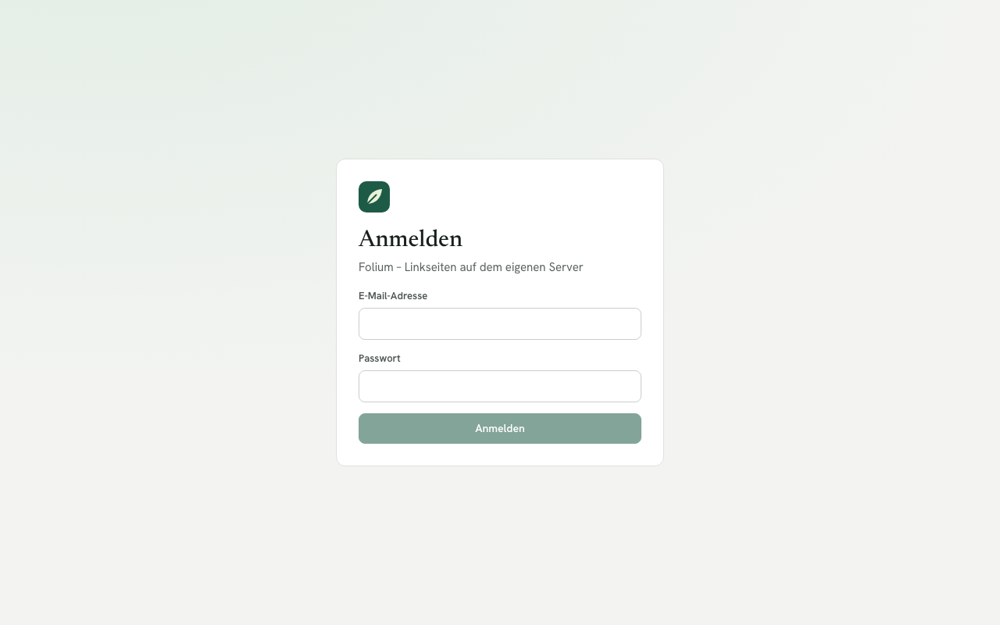

# 13 — Installation

[← Handbuch](README.md) · [Weiter: 14 — Reverse Proxy](14-reverse-proxy.md)

> Dieses Kapitel richtet sich an die IT bzw. an Administratoren des Servers.

Diese Anleitung führt von einem Linux-Server mit Docker zu einem laufenden Folium und zum ersten Login. Den Reverse Proxy davor beschreibt [Kapitel 14](14-reverse-proxy.md).

## Voraussetzungen

- Linux-Server (amd64 oder arm64) mit Docker und **Docker Compose 2.24 oder neuer** (`docker compose version`). Ältere Versionen verstehen die Angabe `required: false` an der `.env` in `docker-compose.yml` nicht.
- Ein Reverse Proxy, der TLS-Zertifikate bereitstellt (Beispiele für Caddy und nginx in [Kapitel 14](14-reverse-proxy.md)).
- Zwei Hostnamen im DNS:
  - einen **öffentlichen** für die Linkseiten, z. B. `links.example.com`,
  - einen **internen** für die Verwaltung, z. B. `folium.intranet.example.com`.
- Internetzugang des Servers: beim Bauen (npm-Pakete, Basis-Images) und im Betrieb für die Homepage-Analyse und die KI. Ohne Internet funktionieren Linkseiten und Verwaltung weiterhin ([Kapitel 18](18-betrieb.md#betrieb-ohne-browser-dienst-oder-ohne-ki)).

## Die zwei Dienste

`docker-compose.yml` startet zwei Container:

| Dienst | Aufgabe | Netz | Grenzen |
| --- | --- | --- | --- |
| `folium` | die Anwendung: öffentliche Linkseiten (Port 8080) und Verwaltung (Port 8081) | Standardnetz und `folium-intern` | 768 MB RAM, 200 Prozesse; Dateisystem schreibgeschützt (außer `/data` und `/tmp`), läuft ohne Root, `cap_drop: ALL`, `no-new-privileges` |
| `folium-browser` | Chromium (Playwright-Server, Image `folium-browser:1.65.1`) für Bildschirmfotos der Homepage-Analyse | **nur** `folium-intern` | 1 GB RAM, 300 Prozesse, schreibgeschützt, `cap_drop: ALL` |

Das Netz `folium-intern` ist als `internal: true` angelegt und hat **keinen Internetzugang**. Der Browser kann deshalb nichts selbst aus dem Netz laden; Folium beantwortet jede seiner Anfragen über den eigenen, geprüften Abruf. Der Browser-Dienst ist optional ([Kapitel 18](18-betrieb.md#betrieb-ohne-browser-dienst-oder-ohne-ki)).

Alle Daten liegen im Docker-Volume `folium-data`, im Container unter `/data`:

| Pfad | Inhalt |
| --- | --- |
| `/data/folium.db` | SQLite-Datenbank (Seiten, Versionen, Konten, Statistik, Einstellungen, Protokoll) |
| `/data/assets/` | hochgeladene Bilder und Schriften |
| `/data/backups/` | Sicherungen ([Kapitel 17](17-sicherung.md)) |

## 1. Dateien auf den Server holen

```bash
sudo mkdir -p /opt/folium && sudo chown "$USER" /opt/folium
git clone https://github.com/PBaumfalk/Folium.git /opt/folium
cd /opt/folium
```

## 2. Konfiguration anlegen

```bash
cp .env.example .env
nano .env
```

Mindestens diese beiden Werte anpassen:

```ini
APP_URL=https://folium.intranet.example.com   # Adresse der Verwaltung, wie sie im Browser aufgerufen wird
PUBLIC_BASE_URL=https://links.example.com     # Standardadresse der Linkseiten
```

Für die KI zusätzlich `ANTHROPIC_API_KEY`, hinter einem Reverse Proxy `TRUST_PROXY`. Alle Variablen erklärt [Kapitel 15](15-konfiguration.md). Die `.env` enthält Schlüssel: Rechte einschränken (`chmod 600 .env`) und nicht in Git einchecken.

Gut zu wissen: Anders als manche Schwesterprodukte startet Folium auch **ohne** `.env`. Dann gelten die Standardwerte `http://localhost:8081` und `http://localhost:8080`, was nur zum Ausprobieren auf dem eigenen Rechner taugt.

## 3. Bauen und starten

```bash
docker compose up -d --build
docker compose ps                                   # beide Dienste "Up", folium nach kurzer Zeit "healthy"
docker compose logs folium | grep Einrichtungscode
```

Der erste Build lädt Node- und Playwright-Images und dauert einige Minuten. Die Logzeile (JSON) enthält:

```
Einrichtungscode: 123-456-789 – unter https://folium.intranet.example.com eingeben, um das erste Admin-Konto anzulegen.
```

Der Code bleibt bis zur Einrichtung gleich, auch über Neustarts hinweg, und wird bei jedem Start erneut ins Log geschrieben. Wer ihn lieber selbst festlegt, setzt `SETUP_CODE` in der `.env`. Es gibt **keine Standardzugangsdaten**.

### Fertige Images statt selbst bauen

Die CI baut bei jedem erfolgreichen Lauf auf `main` beide Images für amd64 und arm64 und legt sie öffentlich in der GitHub Container Registry ab. Eine Anmeldung (`docker login`) ist nicht nötig.

In der `.env`:

```
FOLIUM_IMAGE=ghcr.io/pbaumfalk/folium:latest
FOLIUM_BROWSER_IMAGE=ghcr.io/pbaumfalk/folium-browser:latest
```

Danach `docker compose pull && docker compose up -d` statt `--build`. `latest` folgt dem Hauptzweig. Für feste Stände gibt es nach einem Release (Git-Tag wie `v0.1.0`) zusätzlich Tags je Version: für `folium` `0.1.0` und `0.1`, für `folium-browser` `0.1.0`. Beispiel: `FOLIUM_IMAGE=ghcr.io/pbaumfalk/folium:0.1`.

## 4. Ports und Erreichbarkeit

Im Container lauscht Folium auf zwei Ports. `docker-compose.yml` veröffentlicht sie auf dem Host, standardmäßig nur auf `127.0.0.1`:

| Port | Inhalt | Host-Variablen (Standard) |
| --- | --- | --- |
| 8080 | **öffentlich:** nur veröffentlichte Linkseiten, ihre Bilder und Schriften, Klickzähler, `/healthz`. Keine Verwaltung, keine Entwürfe, keine Cookies. | `PUBLIC_BIND` (`127.0.0.1`), `PUBLIC_HOST_PORT` (`8080`) |
| 8081 | **Verwaltung:** Oberfläche und Schnittstelle | `ADMIN_BIND` (`127.0.0.1`), `ADMIN_HOST_PORT` (`8081`) |

Mit `127.0.0.1` sind die Ports nur für einen Reverse Proxy auf demselben Server erreichbar. Läuft der Proxy auf einem anderen Rechner, `PUBLIC_BIND`/`ADMIN_BIND` auf die passende Schnittstelle setzen und die Ports per Firewall auf den Proxy beschränken. Den Port 8081 nie ins Internet freigeben.

Laufen Filum oder Tessera auf demselben Server, sind 8080/8081 oft schon belegt. Dann z. B. `PUBLIC_HOST_PORT=8090` und `ADMIN_HOST_PORT=8091` setzen und den Proxy entsprechend anpassen.

## 5. Erster Login

1. `APP_URL` im Browser öffnen. Es erscheint **Folium einrichten**.
2. **Einrichtungscode**, **Ihr Name**, **E-Mail-Adresse** und **Passwort** (mindestens 12 Zeichen) eintragen.
3. **Konto anlegen**. Sie sind als Admin angemeldet; der Einrichtungscode ist danach ungültig.



Danach: unter **Einstellungen → Allgemein** Impressum, Datenschutzerklärung und Homepage eintragen; sie sind nach der Installation leer, und ohne Impressum und Datenschutzerklärung lässt sich keine Seite veröffentlichen ([Kapitel 11](11-einstellungen.md#pflichtangaben-für-neue-seiten)). Außerdem weitere Konten anlegen ([Kapitel 10](10-konten-und-rollen.md)), unter **Einstellungen → KI und Verbindungen** einmal **Verbindung prüfen**, eine erste Seite anlegen ([Kapitel 2](02-erste-schritte.md)).

Lautet die Meldung „Der Einrichtungscode stimmt nicht. Er steht im Serverprotokoll.“, den Code erneut aus dem Log kopieren.

## Ausprobieren auf dem eigenen Rechner (Docker Desktop)

Für einen Test auf dem Mac oder Windows-PC genügt Docker Desktop. Im Projektordner eine `.env` mit lokalen Adressen anlegen:

```ini
APP_URL=http://localhost:8081
PUBLIC_BASE_URL=http://localhost:8080
SETUP_CODE=111-222-333
```

```bash
docker compose up -d --build
```

Dann `http://localhost:8081` öffnen und mit dem Code `111-222-333` einrichten. Veröffentlichte Seiten erscheinen unter `http://localhost:8080/<adresse>`.

Gut zu wissen:

- Nicht die `.env.example` mit `https://`-Adressen unverändert übernehmen. Beginnt `APP_URL` mit `https://`, setzt Folium das Sitzungscookie nur für HTTPS (`SECURE_COOKIES`); über `http://localhost` scheitert dann die Anmeldung ohne Fehlermeldung.
- Folium erkennt die Standardadresse am Hostnamen **einschließlich Port**. Wer `PUBLIC_HOST_PORT` ändert, muss `PUBLIC_BASE_URL` anpassen, sonst zeigt jede Seite „Diese Seite gibt es nicht.“
- Aufräumen: `docker compose down -v` entfernt Container **und** Daten. Auf einem echten Server nie `-v` verwenden ([Kapitel 18](18-betrieb.md)).

## Entwicklungs-Demo ohne Docker

Für Entwicklung, Bildschirmfotos und Browser-Tests gibt es eine Demo mit erfundenen Beispieldaten (Seite „Muster & Partner“ in allen drei Designs). Voraussetzung: Node.js 24 (mindestens 22).

```bash
npm ci
npm run build          # baut die Oberfläche nach dist/web
npx tsx scripts/demo.ts
```

| | |
| --- | --- |
| Verwaltung | `http://localhost:18081` |
| Öffentlich | `http://localhost:18080/muster`, `/boutique`, `/signature` |
| Beispiel-Homepage | `http://localhost:18090/` (erfunden, für „Design aus Homepage übernehmen“) |
| Konten | `admin@example.test`, `redaktion@example.test`, `ansicht@example.test`, jeweils Passwort `demo-passwort-123` |
| Daten | Ordner `data-demo/` (beim zweiten Start wiederverwendet; zum Neuanfang löschen) |

`DEMO_BROWSER=1` startet zusätzlich einen lokalen Chromium für Bildschirmfotos, `DEMO_EMPTY=1` legt keine Beispieldaten an. Die Demo ist nicht für den Betrieb gedacht: Sie hat bekannte Passwörter und keine Abschottung des Browsers.

---

[← Handbuch](README.md) · [Weiter: 14 — Reverse Proxy](14-reverse-proxy.md)
